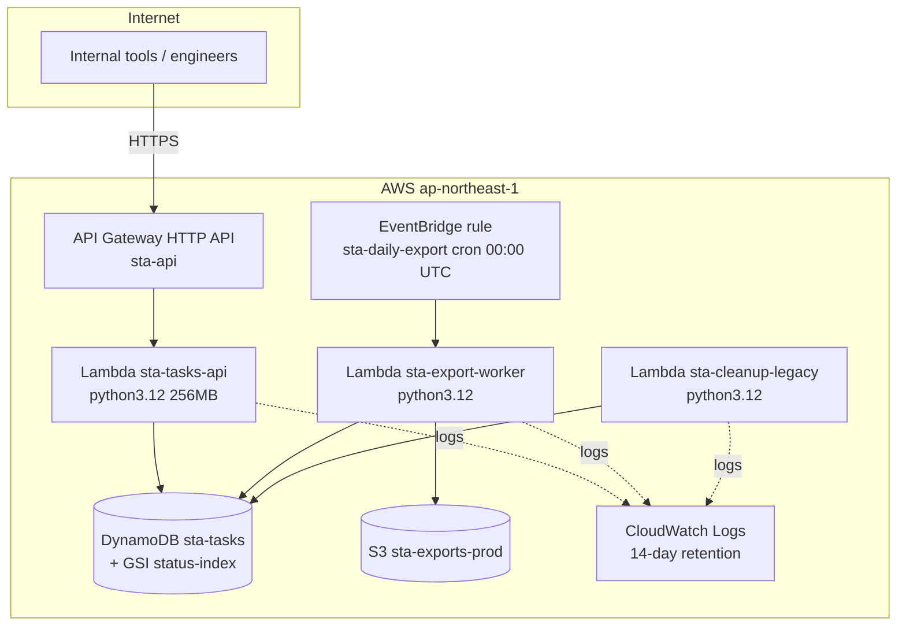

# Task-reminder service internal API — architecture

The workload owner (fictional) runs its internal task/reminder API entirely on AWS serverless primitives in **ap-northeast-1**. One engineer built it in 2023; it has had no dedicated maintainer since. All state lives in DynamoDB; the only scheduled job is a nightly export.

## Main services

| Service | Resource | Purpose |
|---|---|---|
| API Gateway (HTTP API) | `sta-api`, `$default` stage, auto-deploy | Public edge; ANY / and ANY /{proxy+} to the API function |
| Lambda | `sta-tasks-api` | CRUD API: create/list/get/complete tasks, `/health`, `/admin/aws-check` |
| Lambda | `sta-export-worker` | Nightly full-table export to `exports/YYYY-MM-DD.json` |
| Lambda | `sta-cleanup-legacy` | Purges completed tasks >90 days old. **Currently has no trigger** — its cron lived on the old ops EC2 box (decommissioned Nov 2024) and was never re-attached; invoked manually when needed |
| DynamoDB | `sta-tasks` (on-demand) | Task store; GSI `status-index` for status queries |
| S3 | exports bucket | Nightly JSON snapshots, consumed by the ops spreadsheet |
| EventBridge | `sta-daily-export` | cron(0 0 * * ? *) UTC → export worker |
| CloudWatch Logs | `/aws/lambda/sta-*` | 14-day retention |

## Network & security

- No VPC involvement: all functions run on the Lambda public plane; DynamoDB/S3 reached over AWS endpoints.
- IAM: one execution role per function, least-privilege inline policies (API function cannot delete; cleanup function cannot write to S3).
- No secrets: the system holds no credentials beyond IAM roles.

## API surface

| Method & path | Auth | Notes |
|---|---|---|
| POST /tasks | none (internal) | `{title, due_at}` |
| GET /tasks | none | latest 50 |
| GET /tasks/{id} | none | |
| POST /tasks/{id}/complete | none | sets `status=done`, `completed_at` |
| GET /health | none | dependency substatus (DynamoDB, S3) |
| GET /admin/aws-check | none | per-service SDK ping dashboard |

## Operations

- Deploys: `scripts/deploy.sh` (Terraform). No CI — the team deploys from a laptop.
- Exports: ops pulls `exports/YYYY-MM-DD.json` into the weekly spreadsheet each Monday.
- Cleanup: run `sta-cleanup-legacy` by hand when the table passes ~10k items.
- A Slack webhook for overdue-task pings is on the wishlist; not implemented.
