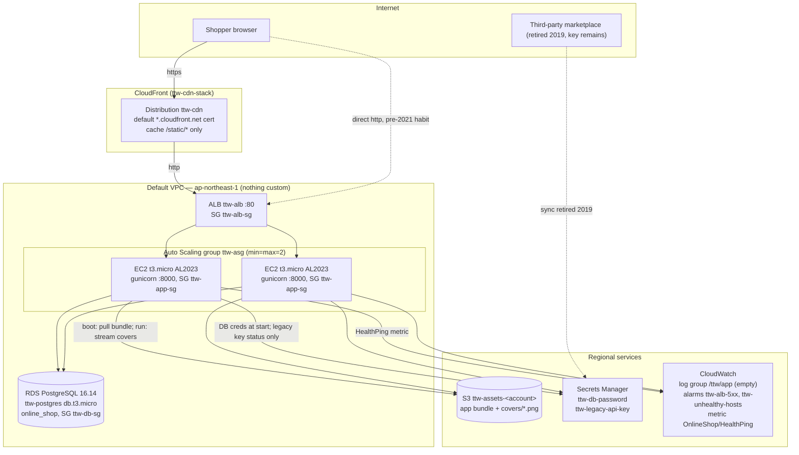

# The online shop (fictional) — web store architecture

The online shop (fictional) is a used- and antiquarian-book shop in Osu, Nagoya (est. 1998, `ttw.example`). The web store went online in 2016: a local contractor lifted the shop's aging on-premise LAMP box into AWS ap-northeast-1 as "the same thing, but on EC2" — a load balancer, two small VMs that install everything they need at boot, and a managed PostgreSQL. The design has not changed since. Two events left scars: a 2021 local-TV feature that melted the two instances (CloudFront was bolted on the following week), and the 2024 PostgreSQL end-of-life notice, which forced a re-bake onto Amazon Linux 2023 and PostgreSQL 16 with zero architectural change. The store lists the catalog, shows scanned covers, and tells you to visit the shop — online checkout never made it off the 2016 wishlist.

Everything is CloudFormation: five stacks with fixed names, chained by exported outputs (`ttw-security-stack` → `ttw-data-stack` → `ttw-compute-stack` → `ttw-cdn-stack` → `ttw-observability-stack`). All compute lives in the account's default VPC — the contractor saw no reason to build a custom one for a bookshop.

## Main services

| Service | Resource(s) | Stack | Notes |
| --- | --- | --- | --- |
| CloudFront | `ttw-cdn` distribution | ttw-cdn-stack | Added 2021 after the TV spike. ALB custom origin over plain HTTP (`http-only` — no origin cert was ever bought); viewers get the default certificate with redirect-to-https. Managed cache policies: CachingDisabled on everything, CachingOptimized on `/static/*` only — the contractor never added `/covers/*`. |
| ALB | `ttw-alb`, target group `ttw-app-tg` (:8000, health check `/health`), HTTP :80 listener | ttw-compute-stack | Internet-facing across the default subnets. HTTP only; TLS terminates at CloudFront (when shoppers use it). |
| EC2 Auto Scaling | Launch template `ttw-app-lt`, ASG `ttw-asg` (min=max=desired=2), instance profile `ttw-app-profile` / role `ttw-app-role` | ttw-compute-stack | AL2023 via the public SSM "latest" parameter (verified 2026-07). UserData does everything: `dnf install python3.11`, pull `app/app.tar.gz` from the assets bucket, `pip3.11 install flask gunicorn boto3 "psycopg[binary]"`, write `/etc/shop.env`, start the `shop` systemd unit (gunicorn `0.0.0.0:8000`, 2 workers, runs as the `shop` user). ELB health checks, 300 s grace. Role: read assets bucket, read/describe both secrets, `cloudwatch:PutMetricData` (OnlineShop namespace), SSM core for shell access. |
| RDS | `ttw-postgres` + subnet group `ttw-db-subnets` | ttw-data-stack | PostgreSQL 16.14 (verified 2026-07), db.t3.micro, 20 GB gp3, single-AZ, not publicly accessible, 1-day backups, deletion protection off. DB `online_shop`, master user `shop`; the password is resolved at stack-create time from `ttw-db-password`. The app self-creates its one table and the 12-book seed at boot. |
| S3 | `ttw-assets-<account>` | ttw-data-stack | Private (public access blocked, SSE-S3). Two prefixes: `app/app.tar.gz` (deploy bundle, read at instance boot) and `covers/*.png` (scanned covers the app streams on `/covers/<id>.png`). |
| Secrets Manager | `ttw-db-password`, `ttw-legacy-api-key` | ttw-security-stack | DB credentials are generated at create (`{"username":"shop"}` + generated `password`). The legacy key is the retired third-party marketplace credential — still the deploy-time placeholder, because after the 2019 retirement nobody had a real value to paste in; the app only surfaces `DescribeSecret` status on `/admin/aws-check`. |
| Security groups | `ttw-alb-sg` (80 ← world), `ttw-app-sg` (8000 ← ALB SG), `ttw-db-sg` (5432 ← app SG) | ttw-security-stack | Plain three-tier chain inside the default VPC. |
| CloudWatch | Log group `/ttw/app` (30-day retention), alarms `ttw-alb-5xx` (>10 ELB 5xx / 5 min) and `ttw-unhealthy-hosts` (≥1 unhealthy target), custom metric `OnlineShop/HealthPing` | ttw-observability-stack | Alarms have **no actions** — the owner checks the console when something feels slow; there is no on-call. |

## Application

Flask 3 on gunicorn (`app:app`, :8000), Python 3.11, psycopg 3. Routes:

| Route | Behaviour |
| --- | --- |
| `GET /` | Redirect to `/books`. |
| `GET /books` | Catalog list from PostgreSQL (12 seeded titles, deterministic). |
| `GET /books/<id>` | Detail page; 404 on unknown id. |
| `GET /covers/<key>` | Streams `covers/<key>` from the assets bucket (`<id>.png` only), 1 h cache header. |
| `GET /health` | `{status, checks:{database, s3}}` — never raises, always 200. |
| `GET /admin/aws-check` | Per-service SDK ping: S3 `list_objects_v2` (max 1), `DescribeSecret` on both secrets, DB `SELECT version()`, CloudWatch `put_metric_data` (OnlineShop/HealthPing), STS caller identity. |

All AWS SDK calls are funneled through `app/aws_clients.py`; configuration arrives exclusively via `/etc/shop.env` (written by the launch template). DB credentials are fetched from Secrets Manager once per process; the catalog bootstraps itself (schema + seed, idempotent) in a background retry loop so fresh instances converge while RDS is still warming up.

## Network & security

- Default VPC only; the deploy script resolves the VPC and its default subnets and passes them as stack parameters. No custom VPC, subnets, or NAT anywhere.
- Three-tier security-group chain: world → `ttw-alb-sg`:80 → `ttw-app-sg`:8000 → `ttw-db-sg`:5432. RDS is not publicly accessible.
- TLS exists only at the CloudFront edge (default certificate). CloudFront → ALB and ALB → instances are plain HTTP — accepted risk from 2021 that nobody has revisited. Shoppers with the pre-2021 ALB URL bookmarked still hit :80 directly.
- No SSH keys: the instance role carries `AmazonSSMManagedInstanceCore`, so the (occasional) operator uses SSM Session Manager.
- Instance role is least-privilege-ish: assets bucket read, the two secrets, one metric namespace.

## Operations

- **Deploys** are a full re-run of `scripts/deploy.sh` (create-or-update on all five stacks + bundle re-upload). Instances only read the bundle at boot, so shipping app changes means an ASG instance refresh (`scripts/seed.sh --refresh`) — in practice the shop rarely ships.
- **Seeding** happens on-instance at boot; the 12-book catalog is fixed and identical everywhere (`ON CONFLICT DO NOTHING`).
- **Monitoring** is the two console alarms plus the `OnlineShop/HealthPing` metric the admin page pushes. Nothing pages anyone.
- **Known debt**: the `/ttw/app` log group was created for a CloudWatch-agent rollout that never got finished — app logs still live in journald on the instances, and the log group has been empty since 2016-era intentions met reality. Cover caching on CloudFront (`/covers/*`) is a second item on the same never-finished list.
- **Backups**: RDS automated backups, 1-day retention. The assets bucket is not versioned; the "backup" is the scan folder on the shop PC.
