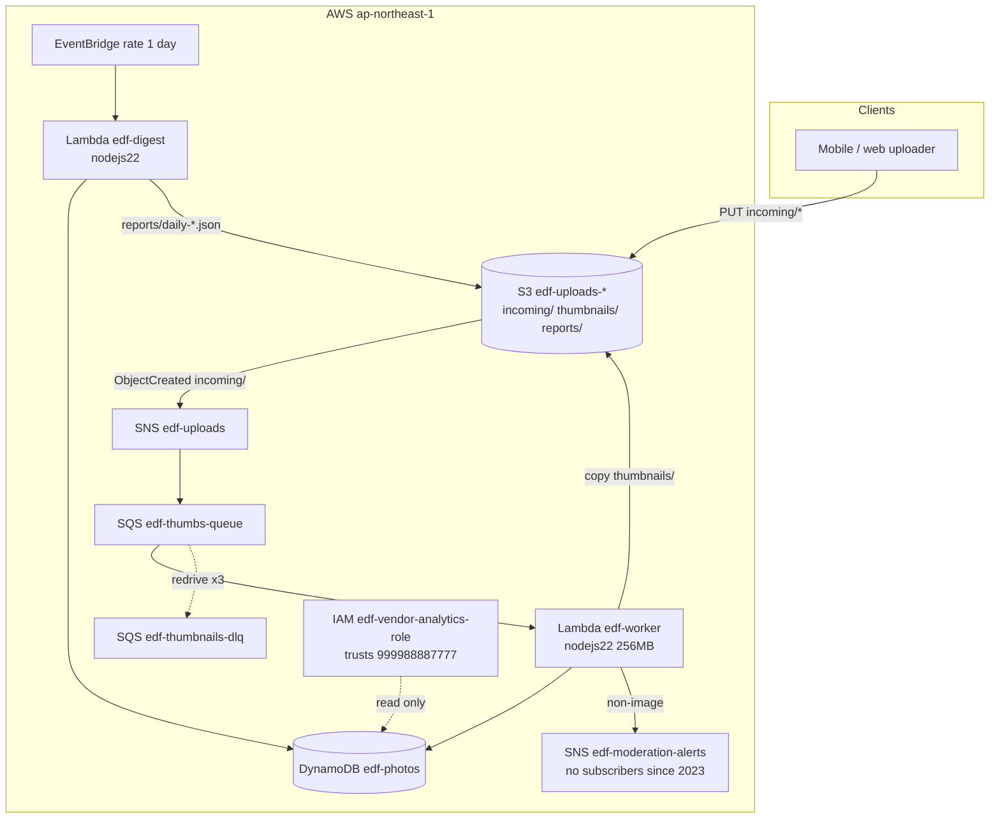

# Photo upload pipeline — architecture

The workload owner (fictional) runs its upload post-processing entirely on AWS event plumbing in **ap-northeast-1**. Built in 2021 by a two-person platform team (both gone by 2023); it has been in keep-the-lights-on mode since. There is no HTTP service in this system — everything is triggered by object uploads and a nightly schedule.

## Main services

| Service | Resource | Purpose |
|---|---|---|
| S3 | `edf-uploads-<account>` | One bucket, three prefixes: `incoming/` (client uploads), `thumbnails/` (worker output), `reports/` (digest output) |
| SNS | `edf-uploads` | Fan-out point for upload events (S3 → SNS → SQS; raw delivery) |
| SQS | `edf-thumbnails-q` (+ `edf-thumbnails-dlq`, maxReceive 3) | Work queue for the ingest worker |
| Lambda | `edf-worker` | Per object: sha256 + size + content type → DynamoDB; server-side copy to `thumbnails/`; non-image uploads raise a moderation alert |
| Lambda | `edf-digest` | Nightly: summarises the last 24h into `reports/daily-YYYY-MM-DD.json` |
| SNS | `edf-moderation-alerts` | Raised by the worker for non-image uploads. **No subscribers** — the on-call that read these left in 2023 and the PagerDuty hook was never rebuilt |
| DynamoDB | `edf-photos` (on-demand) | Photo metadata, keyed by `object_key` |
| EventBridge | schedule `rate(1 day)` | Drives the digest |
| IAM | `edf-vendor-analytics-role` | Read-only cross-account access for an external analytics vendor (account `999988887777`) to pull ingest metrics |

## Security

- No VPC involvement; functions run on the Lambda public plane.
- Function roles are least-privilege: the worker cannot touch `reports/`, the digest cannot write `thumbnails/`.
- The vendor role can only read `edf-photos` — no S3, no queues.
- The "thumbnail" step is currently a server-side copy: real resizing was descoped in 2022 and never picked back up (the pipeline shape is what matters downstream).

## Operations

- Deploys: `scripts/deploy.sh` from a laptop (`aws cloudformation package/deploy`; nobody installed the sam CLI).
- Poisoned messages land in the DLQ after 3 attempts; ops drains it manually (rare).
- Growth marketing reads the daily reports; nothing else consumes them.
- Known wart: moderation alerts fire into the void (see above) — flagged in the 2024 ops review, still unowned.
