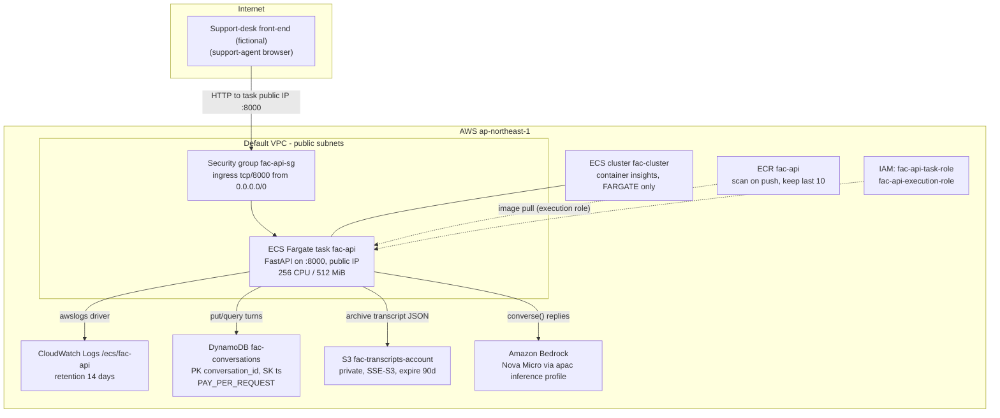

# The support desk (fictional) — fac-api architecture

The support desk (fictional) runs a support-desk SaaS out of the pilot site. In 2025 the team bolted an AI FAQ assistant onto the desk product: a single containerized FastAPI service, `fac-api`, deployed to ECS Fargate in ap-northeast-1. The desk front-end posts customer questions to `/chat`; the service replays recent conversation history to a foundation model on Amazon Bedrock (Nova Micro, via the APAC cross-region inference profile), stores every turn in DynamoDB, and archives closed conversations to S3 as JSON transcripts. The whole stack is defined in Terraform (`terraform/`, hashicorp/aws ~> 6.0) and was sized deliberately small — one task, on-demand Fargate only, pay-per-request storage — because assistant traffic is a fraction of desk traffic.

## Diagram

## Main services

| Service / resource | Name | Purpose | Notes |
| --- | --- | --- | --- |
| ECS cluster | `fac-cluster` | Runs the assistant | Container insights enabled; capacity providers association pins **FARGATE** (on-demand) as the only strategy |
| ECS task definition | `fac-api` | The FastAPI container | 256 CPU / 512 MiB, awsvpc, X86_64; env: `TABLE_NAME`, `BUCKET`, `MODEL_ID`, `BEDROCK_REGION`, `LLM_MODE`, `PORT` |
| ECS service | `fac-api-service` | Keeps 1 task running | FARGATE launch type, default-VPC subnets, `assign_public_ip = true`, **no load balancer** (see Network) |
| Security group | `fac-api-sg` | Task firewall | Ingress tcp/8000 from anywhere; all egress (AWS APIs, image pull) |
| CloudWatch log group | `/ecs/fac-api` | Container logs | 14-day retention |
| ECR repository | `fac-api` | Image registry | Scan on push; lifecycle policy keeps the 10 most recent images |
| DynamoDB table | `fac-conversations` | Conversation turns | Hash `conversation_id` (S), range `ts` (N, nanosecond timestamp); PAY_PER_REQUEST |
| S3 bucket | `fac-transcripts-<account-id>` | Archived transcripts | Private (public access block), SSE-S3 (AES256), lifecycle expires `transcripts/` objects after 90 days |
| Amazon Bedrock | `apac.amazon.nova-micro-v1:0` | FAQ reply generation | Converse API, max 300 output tokens; cross-region APAC inference profile — no infrastructure of ours |
| IAM role | `fac-api-execution-role` | Image pull + log delivery | `AmazonECSTaskExecutionRolePolicy` managed policy attachment |
| IAM role | `fac-api-task-role` | App permissions | Inline policy `fac-api-task-permissions`: Bedrock invoke + list, DynamoDB CRUD on the table, S3 object rw + bucket list on the bucket |

## Application behavior

- `POST /chat {conversation_id?, message}` — loads the last 10 turns, calls the model (or the deterministic stub when `LLM_MODE=stub`, the incident fallback the team can flip without a redeploy), stores the user and assistant turns, returns `{conversation_id, reply, llm_mode}`.
- `GET /conversations/{id}` — full turn history.
- `POST /conversations/{id}/archive` — writes the full history as JSON to `transcripts/{id}.json` in the bucket.
- `GET /health` — dependency substatus (DynamoDB describe, S3 head); always HTTP 200.
- `GET /admin/aws-check` — ops dashboard pinging S3, DynamoDB, Bedrock (model catalog), and STS.

All AWS SDK calls are funneled through `app/aws_clients.py`; reply generation lives in `app/llm.py`.

## Network

The service runs in the account's **default VPC** on public subnets with `assign_public_ip = true`. There is **no load balancer**: the desk front-end is configured with the task's public IP and calls `http://<task-ip>:8000` directly. This is a known wart — the assistant launched as a proof of concept behind one task, an ALB was "phase 2", and phase 2 never happened. Operational consequence: every new deployment (or task replacement) changes the IP, and the front-end config has to be updated from the value `deploy.sh` prints. `fac-api-sg` accordingly allows tcp/8000 from `0.0.0.0/0`.

No NAT gateways: tasks have public IPs and reach AWS APIs over the internet gateway.

## Security

- The task role is scoped to exactly what the app touches: CRUD on `fac-conversations`, object read/write under `fac-transcripts-*`, `bedrock:InvokeModel*` and `bedrock:ListFoundationModels`. Bedrock invoke is `Resource: *` because invocations through a cross-region inference profile resolve to foundation-model ARNs in whichever destination region serves the request, so scoping is by action.
- The transcript bucket blocks all public access and encrypts with SSE-S3.
- No secrets anywhere in the stack: the app authenticates to AWS with the task role, and there are no third-party credentials.
- The API itself is unauthenticated inside the product boundary (the desk front-end is the only intended caller) — another accepted proof-of-concept tradeoff.

## Operations

- Logs: `awslogs` driver to `/ecs/fac-api` (14-day retention); cluster has Container Insights enabled.
- Deploys: build + push to ECR, then `aws ecs update-service --force-new-deployment`; the team then updates the front-end with the new task IP (see Network).
- Tags on every resource via provider `default_tags`: `Owner`, `CostCenter`, `AutoTeardown`, `Journey`.
- Data lifecycle: conversation turns live in DynamoDB indefinitely (pay-per-request keeps this cheap at current volume); archived transcripts expire from S3 after 90 days.
- Model configuration is env-driven: `MODEL_ID` and `BEDROCK_REGION` can be repointed without code changes; `LLM_MODE=stub` is the documented incident fallback when the model misbehaves.
