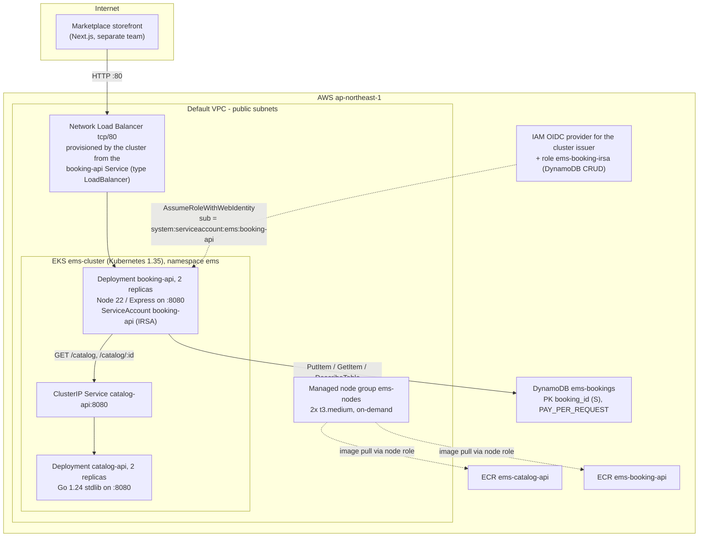

# The equipment marketplace (fictional) — platform architecture

The equipment marketplace (fictional) started in 1998 renting conference phones to Tokyo offices and is now a broad equipment-rental marketplace: AV gear, cameras, radios, portable power. In 2022 the platform team re-platformed the monolith into two microservices on Amazon EKS in ap-northeast-1. The split is deliberately boring: `catalog-api` is a read-only Go service that serves the rentable inventory, `booking-api` is the Node/Express service that owns bookings and doubles as the public API gateway. Bookings land in DynamoDB; the storefront (a separate team's Next.js app) talks HTTP to a network load balancer.

Infrastructure (cluster, nodes, IAM, table, registries) is defined in Terraform under `terraform/` (hashicorp/aws ~> 6.0). Everything that runs *on* the cluster is defined in plain Kubernetes manifests under `k8s/` and applied with `kubectl apply -k` — the platform team keeps the two layers separate on purpose ("Terraform for what the cluster stands on, YAML for what the cluster runs").

## Diagram

## Main services and resources

| Resource | Name | Defined in | Notes |
| --- | --- | --- | --- |
| EKS cluster | `ems-cluster` | `terraform/eks.tf` | Kubernetes **1.35**, standard support (`upgrade_policy.support_type = "STANDARD"`); public API endpoint; auth mode `API_AND_CONFIG_MAP` with bootstrap admin for the deployer |
| Managed node group | `ems-nodes` | `terraform/eks.tf` | 2x `t3.medium`, **on-demand only**, min=max=desired=2, default-VPC subnets |
| IAM role | `ems-cluster-role` | `terraform/iam.tf` | Control plane; `AmazonEKSClusterPolicy` |
| IAM role | `ems-node-role` | `terraform/iam.tf` | Nodes; worker, CNI, and ECR read-only managed policies |
| IAM OIDC provider | cluster issuer | `terraform/iam.tf` | Registers the cluster's OIDC issuer with IAM; audience `sts.amazonaws.com` |
| IAM role | `ems-booking-irsa` | `terraform/iam.tf` | Trust restricted to `system:serviceaccount:ems:booking-api`; inline policy: PutItem/GetItem/UpdateItem/Query/Scan/DescribeTable on the table only |
| DynamoDB table | `ems-bookings` | `terraform/storage.tf` | Hash key `booking_id` (S), PAY_PER_REQUEST |
| ECR repository x2 | `ems-catalog-api`, `ems-booking-api` | `terraform/storage.tf` | Scan on push |
| Namespace | `ems` | `k8s/00-namespace.yaml` | All workloads live here |
| Deployment | `catalog-api` | `k8s/catalog-api.yaml` | 2 replicas, requests 50m/64Mi, `/health` probes; no service account, no cloud API access |
| Service (ClusterIP) | `catalog-api` | `k8s/catalog-api.yaml` | Port 8080; only booking-api calls it |
| ServiceAccount | `booking-api` | `k8s/booking-api.yaml` | Annotation `eks.amazonaws.com/role-arn` -> `ems-booking-irsa`; the only place the role is bound to a workload |
| Deployment | `booking-api` | `k8s/booking-api.yaml` | 2 replicas, requests 100m/128Mi; env `TABLE_NAME`, `CATALOG_URL=http://catalog-api:8080`, `PORT`, `AWS_REGION` |
| Service (LoadBalancer) | `booking-api` | `k8s/booking-api.yaml` | Annotation `service.beta.kubernetes.io/aws-load-balancer-type: "nlb"`; port 80 -> 8080; the cluster's cloud controller provisions the internet-facing NLB — **no load balancer exists in Terraform** |

## Application behavior

`booking-api` (Node 22, Express; all AWS SDK calls funneled through `app/booking-api/awsClients.mjs`):

- `POST /bookings {item_id, days}` — validates the item against catalog-api over the cluster network, computes `total_jpy = daily_rate_jpy * days`, stores `{booking_id (UUID), item_id, item_name, days, total_jpy, status: "confirmed", created_at}`; returns 201.
- `GET /bookings/:id` — the stored booking, or 404.
- `GET /catalog`, `GET /catalog/:id` — proxied to catalog-api, so the storefront needs exactly one endpoint.
- `GET /health` — substatus for DynamoDB and the internal catalog hop; always HTTP 200.
- `GET /admin/aws-check` — ops dashboard proving the pod identity works: DescribeTable + STS GetCallerIdentity, returns `{overall, checks: {dynamodb, sts}, account_suffix}`.

`catalog-api` (Go 1.24, stdlib `net/http` only): `GET /catalog`, `GET /catalog/{id}`, `GET /health`. The 12-item inventory is embedded into the binary at build time from `items.json` (`go:embed`). Known debt: **a price or inventory change requires an image rebuild and redeploy** — fine at today's catalog size, and the team has consciously deferred moving the catalog into a datastore.

## Identity: how booking-api reaches DynamoDB

No static credentials anywhere. The chain is IRSA (IAM Roles for Service Accounts):

1. Terraform registers the cluster's OIDC issuer as an IAM identity provider.
2. `ems-booking-irsa` trusts `AssumeRoleWithWebIdentity` only for `sub = system:serviceaccount:ems:booking-api` and `aud = sts.amazonaws.com`.
3. The `booking-api` ServiceAccount in `k8s/booking-api.yaml` carries the `eks.amazonaws.com/role-arn` annotation; EKS's pod identity webhook injects the token, and the SDK default chain does the rest.

`catalog-api` deliberately has **no** service account and no IAM permissions. The node role can pull images from ECR and nothing else application-visible.

## Network

Everything runs in the account's **default VPC public subnets** — the 2022 replatform kept networking minimal, and there are no NAT gateways (nodes have public IPs and egress via the internet gateway). The only ingress is the NLB on tcp/80; TLS terminates upstream at the storefront's CDN, and the API edge itself is plain HTTP — an accepted tradeoff the security review flags every year. Inside the cluster, booking-api reaches catalog-api by namespace-local DNS (`http://catalog-api:8080`); catalog-api is not reachable from outside the cluster.

## Operations

- Deploys: `scripts/deploy.sh` — Terraform first, then image build/push to ECR (tag = git short SHA), then `envsubst` renders `k8s/` (image registry, tag, role ARN) into `k8s-build/` and `kubectl apply -k` rolls the workloads.
- Replica counts are hand-pinned (2/2); there is no HPA and no cluster autoscaler — the node group is fixed at 2 nodes.
- Logs are `kubectl logs` only; the team never wired container logs into CloudWatch.
- Kubernetes upgrades are done in place a few weeks after each EKS minor release lands in standard support; the cluster tracks **1.35** today.
