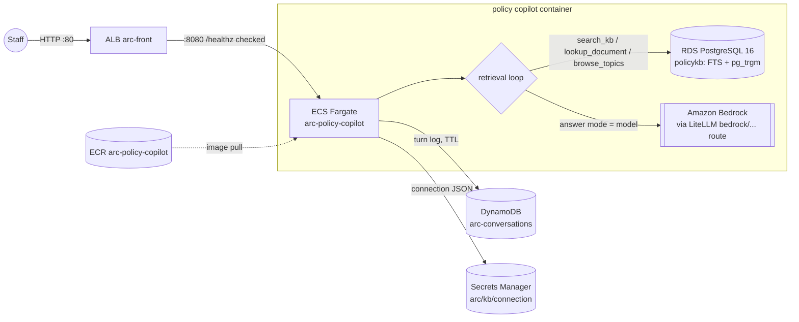

# Architecture — policy copilot

Internal staff tool of a fictional logistics company. One containerized
service; every dependency is a managed AWS store.

Operational notes:

- **Single ingress**: the ALB is the only front door; the target group health
  check is `GET /healthz`.
- **The retrieval loop is the product.** The agent (google-adk) must judge
  its first search and re-query before answering; `/ask` responses expose the
  loop as `steps[]` so clients can render "how I found this".
- **Two answer modes.** `pipeline` executes the same loop as deterministic
  code (no model dependency — the account's Bedrock quota is zero);
  `model` runs the agent against Bedrock through LiteLLM with the task
  role's credentials. No API keys exist in this system.
- **Conversation memory is application-owned**: an item-per-turn DynamoDB
  partition with TTL; the service replays a window of turns into context on
  each request. There is no framework session object in storage.
- **Retrieval is lexical**: Postgres full-text (`websearch_to_tsquery`,
  `ts_rank_cd`, GIN) plus trigram similarity as a hint for misspellings.
  No embeddings anywhere in the estate.
