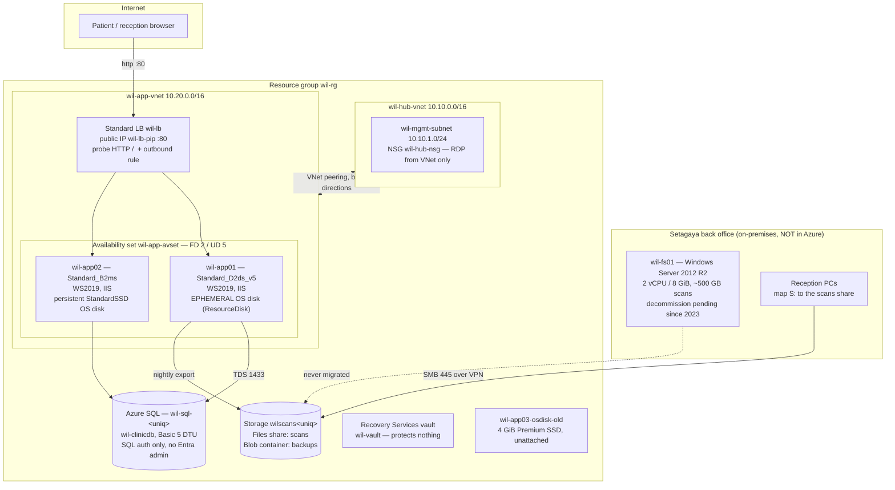

# The clinic group (fictional) — Azure estate

The clinic group (fictional; `wil.example`) runs four small private clinics in
Setagaya, Tokyo, founded 2004. It employs no IT staff; a two-person contractor in Sangenjaya has looked
after the systems since the beginning.

The estate is a line-of-business Windows stack that was never designed so much as accumulated. The
reservation-and-records portal was written in ASP.NET in 2009 and ran on a pair of tower servers in the
Setagaya back office until **2021**, when the contractor lifted them into Azure as virtual
machines — same OS, same application, same two-server shape, a load balancer in front, and SQL Server
replaced by Azure SQL Database because nobody wanted to license and patch a database VM. That was the
last architectural decision anyone made. In **2023** the group's third app server, `wil-app03`, was
retired after a consolidation, and `wil-app01` was rebuilt onto a newer VM size in the same week.

The clinic holds an **Enterprise Agreement with active Software Assurance for Windows Server**,
purchased when the estate was still on-premises and renewed since. The contractor has always described
the Azure VMs as "covered by our licences".

One server never made the 2021 move. `wil-fs01`, a Windows Server 2012 R2 file server, still sits in the
Setagaya back office holding a decade of scanned paperwork. It has been listed as
**decommission pending** on the contractor's own notes since 2023 — the plan was always to fold it into
Azure Files and switch it off, and the plan has never been executed.

## Main services

| Service           | Resource(s)                                                                                                                                                       | Notes                                                                                                                                                                                                                                                                                                                                                                                                                                                                                                                                                                                                               |
| ----------------- | ----------------------------------------------------------------------------------------------------------------------------------------------------------------- | ------------------------------------------------------------------------------------------------------------------------------------------------------------------------------------------------------------------------------------------------------------------------------------------------------------------------------------------------------------------------------------------------------------------------------------------------------------------------------------------------------------------------------------------------------------------------------------------------------------------- |
| Networking        | `wil-hub-vnet` (10.10.0.0/16), `wil-app-vnet` (10.20.0.0/16), peered in both directions                                                                           | Hub-and-spoke because a Microsoft partner slide in 2021 said so. The hub holds a management subnet and nothing else — no firewall, no gateway, no jump box was ever built. **No custom DNS servers**: every VM uses Azure-provided DNS, which is why nothing in Azure can resolve or join the clinic's on-premises domain.                                                                                                                                                                                                                                                                                          |
| Load balancing    | `wil-lb` (Standard SKU), `wil-lb-pip` (Standard, static), HTTP :80 rule, HTTP health probe on `/`, one outbound rule                                              | Standard SKU throughout — Basic public IPs and Basic load balancers were retired 2025-09-30. The outbound rule is the estate's only egress path, so `disableOutboundSnat` is set on the load-balancing rule to let the outbound rule own SNAT on the shared frontend address. TLS was never configured; the portal is plain HTTP and reached over the clinic VPN.                                                                                                                                                                                                                                                   |
| Compute           | `wil-app01` (`Standard_D2ds_v5`), `wil-app02` (`Standard_B2ms`), both Windows Server 2019 in availability set `wil-app-avset` (2 fault domains, 5 update domains) | The two servers have never matched, and nobody has ever tidied it up. `wil-app02` is the 2021 original on burstable B-series with an ordinary managed OS disk. `wil-app01` was rebuilt in 2023 by a stand-in contractor who selected a newer size and ticked the ephemeral OS disk option for faster reimaging. Both run IIS, installed by a CustomScriptExtension at provisioning time.                                                                                                                                                                                                                            |
| Ephemeral OS disk | `wil-app01` only — `diffDiskSettings` `{ option: Local, placement: ResourceDisk }` with `caching: ReadOnly`                                                       | A live operational constraint, not a footnote. The OS disk lives on the VM's 75 GiB temp disk, so **`wil-app01` cannot be stop-deallocated** — stopping it destroys the OS state. It cannot be snapshotted, backed up by Azure Backup, or protected by Site Recovery. Guest patching is enabled on both VMs, and on `wil-app01` every patch is lost on reimage.                                                                                                                                                                                                                                                     |
| Database          | `wil-clinicdb` on logical server `wil-sql-<uniq>`, Basic tier (5 DTU, 2 GB)                                                                                       | Migrated off SQL Server Standard in 2021. **SQL authentication only** — no Microsoft Entra administrator was ever configured, so the application connection string carries a username and password. The firewall has a single rule, the `0.0.0.0`-`0.0.0.0` "allow Azure services" entry, because the app servers egress through the load balancer frontend rather than a fixed address the contractor could pin.                                                                                                                                                                                                   |
| Storage           | `wilscans<uniq>` — SMB file share `scans`, blob container `backups`                                                                                               | `minimumTlsVersion` is explicitly `TLS1_2` and HTTPS-only is on; the account is clean on transport security. Reception staff at all four clinics map the `scans` share as `S:` **using their Active Directory sign-in**, which is how the contractor describes it and how the clinic experiences it — the mapping is scripted at logon from the on-premises domain. What is actually deployed is a plain storage account with **shared-key authentication**: Azure Files AD DS integration was scoped in the 2021 project plan and never configured. The credential in the logon script is the storage account key. |
| Backup            | `wil-vault` (Recovery Services vault, Standard)                                                                                                                   | Created during the 2021 project, given the default policy, and **empty ever since** — it has never listed a protected item. There is no backup of the app servers. The clinic believes there is.                                                                                                                                                                                                                                                                                                                                                                                                                    |
| Orphaned storage  | `wil-app03-osdisk-old` — 4 GiB Premium SSD, unattached                                                                                                            | The OS disk of the third app server, deleted in the 2023 consolidation. The VM went; the disk stayed, attached to nothing, and has billed every month since.                                                                                                                                                                                                                                                                                                                                                                                                                                                        |

## Application

The reservation-and-records portal is an ASP.NET application that predates the Azure move and is out of
scope for this test bed — it is not in this repository and is not deployed. What deploys in its place is
an IIS static status page, written by the CustomScriptExtension, so the load balancer probe and
`scripts/smoke-test.sh` have a real HTTP 200 to assert against. In the clinic's actual estate, that same
IIS instance serves the portal on port 80 and talks to `wil-clinicdb` over TDS.

Configuration lives where the 2009 application put it: `web.config` on each server, edited by hand, with
the SQL connection string and the storage account key in plain text. The two servers are kept in step by
remembering to edit both.

## Network & security

- Hub-and-spoke with bidirectional peering, no gateway and no on-premises circuit. The clinic reaches
  Azure over a consumer-grade IPsec VPN terminated on the back-office firewall, which is outside this
  template.
- Three network security groups' worth of intent, expressed in two: RDP is reachable only from inside
  the address space, HTTP :80 only from the internet. Health probes ride Azure's default
  `AllowAzureLoadBalancerInBound` rule.
- No TLS anywhere in the data path. The portal is HTTP, the SQL connection is encrypted only because
  Azure SQL requires it, and the only place a certificate exists is Azure's own storage endpoint.
- No managed identities. No Key Vault. Secrets are the SQL password in `web.config` and the storage
  account key in a logon script.
- Identity is entirely on-premises: one Active Directory domain in the Setagaya back office, no Entra ID
  Connect, no domain controller in Azure, no Entra administrator on the SQL server.

## Operations

- **Deploys** happen by RDP. The contractor logs into each app server in turn and copies files. There is
  no pipeline, no artifact store, and no record of what version is running.
- **Patching** is `AutomaticByOS` on both VMs — Windows Update, unattended, whenever it decides.
- **Monitoring** is a phone call from the clinic. There are no alerts, no Log Analytics workspace, and no
  Application Insights. Boot diagnostics are enabled and have never been read.
- **Backups** do not exist in practice. The vault shows no protected items: enrolling `wil-app01` was
  attempted the week the vault was built, the job failed the same night, and after two more tries nobody
  went back to it. `wil-app02` was never enrolled at all. The scanned documents on `wil-fs01` are copied
  to a USB drive that lives in the same building.
- **Known debt**, in the contractor's words: retire `wil-fs01` and move the scans to Azure Files "when
  there's time"; work out whether the Software Assurance licences are actually being applied to the two
  Azure VMs, because the invoice has never obviously changed; and settle what to do with
  `wil-app03-osdisk-old`, 4 GiB of premium SSD attached to nothing that surfaces on the invoice about
  once a year — nobody still at the firm knows whether anything on it is wanted, and the stand-in
  contractor who ran the 2023 consolidation has long since moved on.
