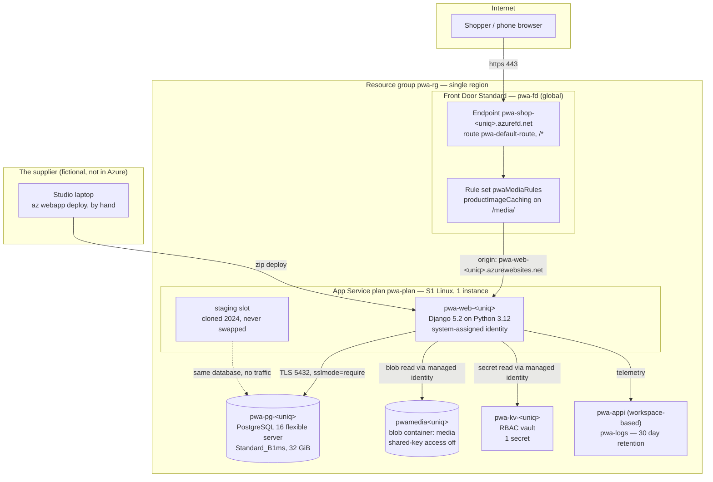

# The stationery shop (fictional) — Azure estate

The stationery shop (fictional; `pwa.example`) sells pens and paper. The shop itself is a narrow
frontage on a covered shopping street near the local market, opened in **2016** and still run by
the family that opened it. Four people work there. Nobody at the shop works in IT.

The online shop was written in **2019** by the supplier (fictional), a two-person web studio ten minutes' walk
away, as a Django application on a rented VPS. It sold well enough through 2020 and 2021 that
the VPS became the thing everyone worried about, and in **2022** the studio moved it to Azure: the same
Django code onto App Service, and the same PostgreSQL onto a flexible server sized to match what the VPS
had been. Nothing about the application changed in the move.

In **2024**, over the Golden Week holiday, the shop ran a regional-crafts feature and the site slowed to
the point where the owner started getting messages about it. The studio traced it to product images being
served out of the application on every request, and put **Front Door** in front of the site the following
week, with a rules-engine rule that holds anything under `/media/` at the edge for a day. They created a
**staging slot** in the same fortnight so the Front Door change could be tried somewhere before it went
live. The slot was used twice that month.

In **2025** the shop's card processor sent a security questionnaire, and the studio spent a weekend on
what they called a tidy-up: a **Key Vault**, a **managed identity** on the web app with role assignments
instead of connection strings, and shared-key access switched off on the storage account. The same
weekend they created a secret for the checkout webhook signing key, with a stand-in value in it, on the
understanding that the processor would issue the real key when the webhook integration was built. The
webhook integration was scheduled for the autumn and then postponed. The secret has been sitting there
since.

## Main services

| Service        | Resource(s)                                                                                                                                          | Notes                                                                                                                                                                                                                                                                                                                                                                                                                                                                                                                                     |
| -------------- | ---------------------------------------------------------------------------------------------------------------------------------------------------- | ----------------------------------------------------------------------------------------------------------------------------------------------------------------------------------------------------------------------------------------------------------------------------------------------------------------------------------------------------------------------------------------------------------------------------------------------------------------------------------------------------------------------------------------- |
| Edge           | `pwa-fd` (Front Door Standard), endpoint `pwa-shop-<uniq>`, origin group `pwa-web-origin-group`, route `pwa-default-route`, rule set `pwaMediaRules` | Added in 2024 for one reason: stop product images touching the application. The single rule matches paths beginning `/media/`, overwrites `Cache-Control` on the way out, and overrides the route's cache settings to hold the object for a day with query strings ignored. Everything else on the site passes through uncached. There is no custom domain and no WAF policy attached: the Standard tier carries custom rules only, and the managed rule set the card processor's questionnaire asked about would mean moving to Premium. |
| Compute        | `pwa-plan` (S1 Standard, Linux, one instance) and `pwa-web-<uniq>`                                                                                   | S1 rather than a burstable plan because the studio wanted the staging slot, and slots start at Standard. One instance has always been enough; nobody has ever configured autoscale. Health check path is `/health`, which is also what Front Door probes.                                                                                                                                                                                                                                                                                 |
| Staging slot   | `pwa-web-<uniq>/staging`                                                                                                                             | Created during the 2024 Front Door work by cloning production's configuration at the time, used twice that month, and left alone since. Its settings are therefore a snapshot of the shop as it was in 2024, not as it is now — including where it thinks product images live. Nothing routes traffic to it and nothing has ever been swapped out of it.                                                                                                                                                                                  |
| Database       | `pwa-pg-<uniq>` — PostgreSQL 16 flexible server, `Standard_B1ms` (Burstable), 32 GiB, no HA, 7 day backups                                           | Sized in 2022 to match the VPS it replaced and never revisited, because nothing has ever obviously broken. Public endpoint with the single `0.0.0.0`-`0.0.0.0` "allow Azure services" firewall rule, since App Service egresses from shared addresses the studio could not pin to a range. Password authentication only; Entra authentication was never turned on.                                                                                                                                                                        |
| Product images | `pwamedia<uniq>` — one private blob container, `media`                                                                                               | `minimumTlsVersion` is explicitly `TLS1_2`, HTTPS-only is on, public blob access is off, and shared-key access was switched off in the 2025 tidy-up, so the only way in is Entra ID. The container was reorganised in 2024: images moved into a fresh `media` container, the previous one was left in place for a while and then removed during the same 2025 weekend.                                                                                                                                                                    |
| Secrets        | `pwa-kv-<uniq>` — RBAC permission model, one secret, `checkout-webhook-signing-key`                                                                  | The vault holds exactly one secret and the shop has never rotated it. Production reads it two ways: the application asks the vault directly at start-up, and App Service also resolves it into an application setting through a vault reference. The value in it is the stand-in the studio wrote when they created the vault, pending a key from the card processor that has not been issued.                                                                                                                                            |
| Identity       | System-assigned managed identity on `pwa-web-<uniq>`, two role assignments                                                                           | Key Vault Secrets User scoped to the vault, Storage Blob Data Reader scoped to the storage account. This is the whole of the shop's identity story — no user-assigned identities, no service principals, no secrets in configuration beyond the database password. The staging slot has no identity of its own and was never given one.                                                                                                                                                                                                   |
| Monitoring     | `pwa-appi` (workspace-based Application Insights) over `pwa-logs` (Log Analytics, 30 day retention)                                                  | Wired into the Django application through the OpenTelemetry distro and the connection string in an application setting. It collects. Nobody at the shop has an Azure login, and the studio opens it when something is already known to be wrong.                                                                                                                                                                                                                                                                                          |

## Application

A small Django 5.2 storefront on Python 3.12, in `app/`. Six products in three categories, read from
PostgreSQL; product images held in blob storage and served back through the application at `/media/…`,
which is the path Front Door caches. There is no cart and no checkout — the shop takes orders through the
card processor's own hosted pages, which is why the webhook signing key matters and why nothing else
about payments lives in this code.

Every Azure SDK call in the application goes through one module, `app/webshop/azure_clients.py`:
`DefaultAzureCredential` for authentication, `BlobServiceClient` for images, `SecretClient` for the
checkout key. Two operational endpoints sit alongside the shop pages — `GET /health`, which reports the
database, blob and vault dependencies and answers even when they are down, and `GET /admin/azure-check`,
a per-service dashboard the studio built so they could tell over the phone which dependency had gone.

Configuration is entirely application settings. The studio's rule is that nothing about an environment
lives in the repository, and they have kept to it.

## Network & security

- **No virtual network.** App Service runs on the shared plan with no VNet integration; the database, the
  storage account and the vault all sit on public endpoints. There are no private endpoints anywhere in
  the estate. This was raised in the 2025 tidy-up and set aside as more work than the weekend allowed.
- **Front Door is not enforced.** The App Service site is reachable directly on its
  `azurewebsites.net` name; nothing restricts the origin to Front Door traffic. So is the staging slot, on
  its own host name.
- **TLS everywhere on the data path.** HTTPS-only on the site and the slot, `minTlsVersion` 1.2 on both,
  `sslmode=require` on the database connection, `TLS1_2` floor on storage.
- **Entra ID for data access, passwords for the database.** Blob and vault access are role assignments on
  the web app's managed identity. The database is the exception: administrator login and password, held
  in an application setting.
- **No custom domain and no certificate management.** The shop links to the `azurefd.net` host name from
  its social accounts and from a printed card in the shop.

## Operations

- **Deploys** are a zip push from a studio laptop, by hand, whenever a change is ready. There is no
  pipeline and no build server. The studio keeps the source in a private repository and tags nothing.
- **The staging slot** is available and is not used. Both people at the studio know it is there; the
  habit of pushing straight to production predates it by five years and never changed back.
- **Migrations** are run from the same laptop against the public database endpoint, with a firewall rule
  opened for the studio's address and removed afterwards.
- **Monitoring** is Application Insights nobody opens and a phone call from the shop. The owner rings
  when the site "feels heavy", which happens most reliably on weekday mornings when the shop uploads the
  previous evening's orders, and reliably again every September when the school year restocks. The
  studio's answer has been to ask the shop to avoid bulk edits during the day.
- **Backups** are the flexible server's own seven days of automatic backups and nothing else. Blob
  storage has a seven day soft-delete window on the container. There has never been a restore drill.
- **Known debt**, in the studio's words: finish the payment webhook and put the real signing key in the
  vault "before anyone notices"; work out whether the staging slot is worth keeping or should be deleted,
  since it has drifted far enough from production that they no longer trust what a swap would do; put the
  site behind a proper domain; and look again at the database size, which was picked in 2022 by matching
  the old VPS and has never been reviewed against what the shop actually does now.
