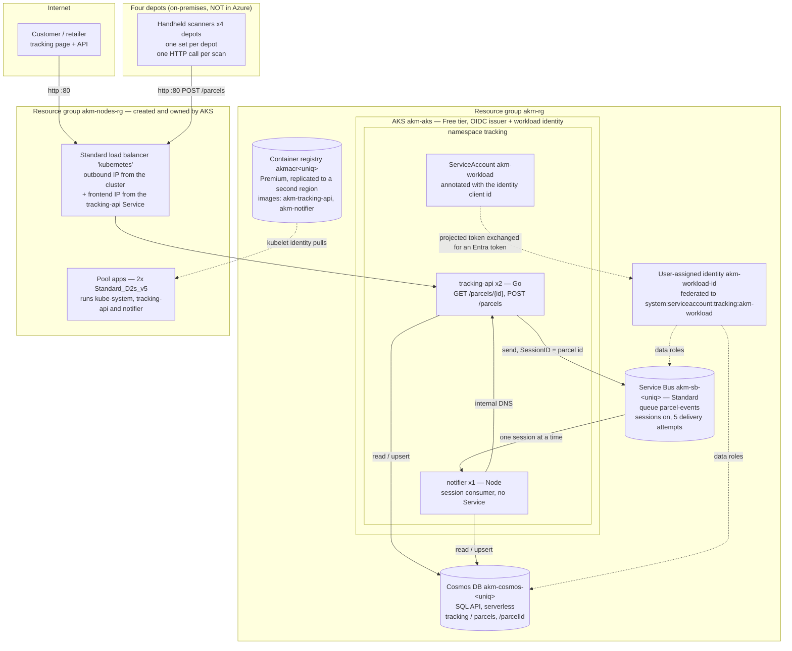

# The parcel-tracking platform (fictional) — Azure estate

The parcel-tracking platform (fictional; `akm.example`) belongs to a regional parcel operator in the east
region, founded in 1998 with two trucks and a phone. It now runs about ninety vehicles out
of four depots — all within its home region — and moves same-day and next-day parcels for
online retailers who are too small to interest the national carriers.

Parcel tracking was a paper manifest and a call-back number until **2019**, when a contractor put a
classic ASP tracking page on a server in the original depot office. In **2022** two developers hired from a
big-city agency rewrote it: a Go API and a Node worker on an AKS cluster, with parcel documents in Cosmos DB
and depot scans on a Service Bus queue. The pool the services run on was sized against the business case
written at the time, which had same-day retail volumes tripling inside a year, and it has been the same
two general-purpose machines ever since. All four depots have been scanning since **2023**, and the
services are in use continuously from the first collection round at 08:00 until the last depot closes at
20:00. The volume in the business case never arrived — the busiest hour of the day is a few hundred
lookups a minute, the two nodes have looked the same on the portal's charts since the second depot came
online, and nobody has revisited the sizing in four years.

Sessions were turned on in the queue in **2023**, a few weeks after the handhelds went out. Customers
were phoning to say the tracking page had shown their parcel as delivered and then, an hour later, as
picked up. Two worker pods had been processing scans for the same parcel at the same time and writing
them back out of order.

In **March 2025** the company planned an expansion with a new western depot, and the registry was
moved to the Premium tier and replicated into a second Azure region as the first piece of groundwork —
images first, everything else later. The depot lease fell through that autumn and the expansion was
shelved. Nothing has ever been pulled from the second region, and the registry has stayed where the plan
put it.

The two developers still maintain the services part-time. A nearby contractor looks after the
subscription, the Terraform, and the invoice.

## Main services

| Service       | Resource(s)                                                                                                                                                         | Notes                                                                                                                                                                                                                                                                                                                                                                                                                      |
| ------------- | ------------------------------------------------------------------------------------------------------------------------------------------------------------------- | -------------------------------------------------------------------------------------------------------------------------------------------------------------------------------------------------------------------------------------------------------------------------------------------------------------------------------------------------------------------------------------------------------------------------- |
| Cluster       | `akm-aks`, Free tier, Azure CNI overlay                                                                                                                             | One pool, no autoscaler. The cluster's own virtual network is created by AKS, so there is no network configuration in the platform code at all.                                                                                                                                                                                                                                                                            |
| Node pool     | `apps` — 2x `Standard_D2s_v5`, 64 GiB managed OS disks                                                                                                              | The only pool: kube-system, tracking-api and notifier all schedule onto the same two machines. The size and the count both come from the 2022 business case and neither has been touched since. There is no autoscaler, and the two services between them ask for well under a third of one machine.                                                                                                                       |
| Node group    | `akm-nodes-rg`                                                                                                                                                      | AKS makes its own resource group for the node VMs and puts the load balancer there too. It is not in the platform code and nobody edits it by hand.                                                                                                                                                                                                                                                                        |
| Registry      | `akmacr<uniq>`, **Premium**, replicated to a second region                                                                                                          | Basic until March 2025, when the expansion plan moved it to Premium so a second region could be added. The western depot never opened. Both images are pushed to the primary region and pulled from the primary region; the replica has served nothing. The admin account is off — the cluster's kubelet identity holds `AcrPull`.                                                                                         |
| Messaging     | `akm-sb-<uniq>` (Standard), queue `parcel-events` with sessions required, 5 delivery attempts, 1-day message lifetime                                               | One message per handheld scan, with the parcel id as the session id. A receiver holds one parcel's session at a time, which is what stopped the out-of-order tracking pages in 2023. A message that fails five times is moved to the queue's dead-letter side; a developer reads that by hand roughly monthly and has never found more than a handful.                                                                     |
| Database      | `akm-cosmos-<uniq>`, SQL API, **serverless**, database `tracking`, container `parcels` partitioned on `/parcelId`, Session consistency                              | One document per parcel holding the current status and the whole scan history, read and written whole. Serverless because overnight traffic is close to nothing and nobody wanted to size throughput for a load that swings by two orders of magnitude between 03:00 and 11:00. No change-feed consumers, no stored procedures, no triggers — the scan history is a plain array on the document.                           |
| Pod identity  | `akm-workload-id` (user-assigned) + a federated credential naming `system:serviceaccount:tracking:akm-workload`                                                     | Both services run as the one Kubernetes service account, and that account is the whole authentication story. There are no connection strings, no account keys and no client secrets anywhere in the estate — not in the manifests, not in the images, not in the developers' notes. The federated credential names the namespace and the service account literally, so renaming either half silently breaks both services. |
| Authorization | `AcrPull` on the registry to the kubelet identity; Service Bus Data Sender + Data Receiver at namespace scope; Cosmos DB Built-in Data Contributor at account scope | Both services share one identity and therefore share every role. Sender and receiver were granted together because splitting them meant two service accounts and two federated credentials, and nobody thought it was worth it for two services.                                                                                                                                                                           |
| Public edge   | The `kubernetes` Standard load balancer in `akm-nodes-rg`, and the public IP the `tracking-api` Service adds to it                                                  | Neither is written down anywhere. AKS builds the load balancer and an outbound address with the cluster; the `type: LoadBalancer` Service in the manifests then adds its own frontend address to it, and takes that address away again when the Service is deleted. So the public address changes whenever the Service is recreated, which the retailers' allowlists have been caught out by twice.                        |

## Application

Two services, both small, both in the same repository as the platform code.

**tracking-api** (Go) is the public edge. It serves the tracking lookup that the retailers' sites embed
and the endpoint the handhelds post to. `POST /parcels` writes the parcel document and then puts a scan
event on the queue with the parcel id as the session id; `GET /parcels/{id}` reads the document straight
back. Two replicas, because one felt fragile and three felt like more than the depot load needed. Every
Azure call is funnelled through `internal/azclients/` — a convention the lead developer imposed in 2022
after the first version had SDK calls scattered through the handlers.

**notifier** (Node) is the worker. It locks one parcel's session, drains whatever scans have arrived for
that parcel, applies them to the document in order, stamps `notifiedAt`, and releases the session. One
replica; the queue does the mutual exclusion, so more replicas would simply work on more parcels at once
and nobody has needed that. Its Azure calls are funnelled through `azureClients.mjs` for the same reason.
It has a `/health` port for the kubelet's probes and no Service in front of it; that page also calls
tracking-api over the cluster's internal DNS, so one `kubectl port-forward` says whether both halves of
the pipeline are up.

Neither service has any credentials to configure. Everything else — endpoints, database and container
names, the queue name — arrives as environment variables set in the manifests.

## Network & security

- No virtual network is declared anywhere. AKS creates its own for the cluster, in `akm-nodes-rg`, and
  the estate has never needed anything else — there is no on-premises circuit, no VPN and no peering. The
  handhelds reach the API over the public internet on the depots' ordinary broadband.
- **The public edge is plain HTTP.** TLS was going to be added "when we get a domain sorted out", and
  four years later the retailers still embed a bare IP address. The tracking page carries no personal
  data beyond a parcel status, which is how the company has justified leaving it.
- No private endpoints. Cosmos DB and Service Bus are both reached over their public endpoints, from pods
  whose only credential is a federated Entra token.
- No Key Vault, because there are no secrets to put in one. This is the one part of the 2022 rewrite
  everyone is still pleased with.
- Nothing in the estate is reachable by password. The registry's admin account is off, Cosmos DB is
  reached with its data-plane role system rather than an account key, and Service Bus has no shared
  access policy in use.

## Operations

- **Deploys** are `kubectl apply` from a developer's laptop, against a kubeconfig fetched with
  `az aks get-credentials`. Images are built locally and pushed to the registry by hand. There is no
  pipeline and no record of which image tag is running other than what `kubectl` reports.
- **The platform and the workloads are maintained separately, by different people.** The contractor owns
  the Terraform and never touches the manifests; the developers own the manifests and have never run
  `terraform apply`. Replica counts, environment wiring, which service calls which, and the public edge
  itself all live only on the manifest side.
- **Patching** is whatever AKS does on its own. The cluster has no pinned version — it took whatever was
  default when it was created and has been upgraded by the platform since.
- **Monitoring** is a developer running `kubectl logs` when a retailer complains. There is no Log
  Analytics workspace, no Application Insights, no metrics and no alerts. The decision was made on cost
  in 2022 and has never been revisited.
- **Backups** of the parcel documents do not exist. Cosmos DB's own default backup is on because it comes
  on, and nobody has ever tested a restore.
- **Known debt**, in the contractor's words: work out whether the second registry region is still worth
  paying for now that the expansion is not happening; work out whether two machines of that size were ever
  needed, given the charts have not come off the floor since 2023; put a name and a certificate in front
  of the API before a
  retailer insists on it; and write down somewhere other than one developer's head that the identity in
  Entra is tied to the exact namespace and service-account name in the manifests.
