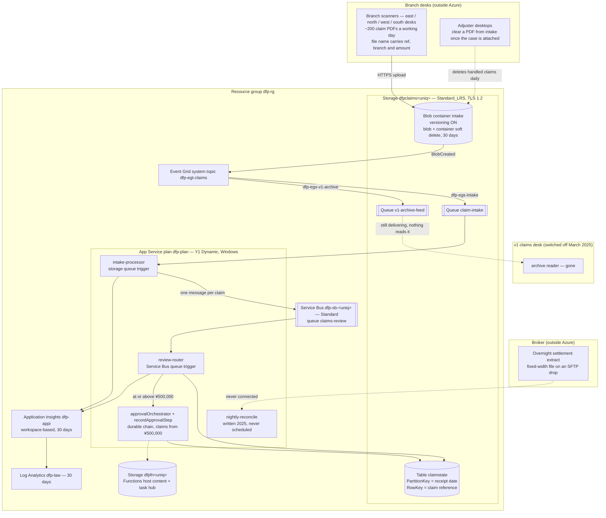

# The claims-intake operator (fictional) — Azure estate

The claims-intake operator (fictional; `dfp.example`) is a claims-handling agency in central
Tokyo, founded in 1998. It does not underwrite anything: regional non-life insurers and one large broker
outsource their motor and small-property claims to it. Forty-one staff across a head office and four
branch desks — east, north, west, south — settle roughly two hundred claims a working day.

Until 2019 a claim arrived by fax or post, was scanned at the branch, and lived on a Windows file server
at head office. In **2023** the broker made digital intake a contract term: every claim acknowledged in
twenty-four hours, with an auditable state history. The operator has no IT staff, so it hired the two-person
integration shop it had used for its website — still on a retainer of two days a month — and they built
the current pipeline in six weeks. It has run essentially unchanged since.

The shape of it reflects who built it and when. The functions are **Node**, because the broker published
its integration samples in Node and copying them was faster than translating them. The plan is the
serverless one the portal offered in 2023. Claim state went into **Table Storage** because the storage
account was already there and the integrator described it as "free next to everything else". Late in
2023, after a claim for ¥1.4m was settled by a junior adjuster who should not have had the authority, a
**two-step approval chain** was added for anything at or above ¥500,000; the integrator reached for
Durable Functions because the alternative was hand-rolling the state machine.

Three things happened afterwards that nobody has undone.

The **2024 compliance response** asked for recoverability on the claims documents. The integrator turned
on blob versioning, blob soft delete and container soft delete in one sitting, all on the same thirty-day
clock, and the item was closed. Nobody modelled what it would cost against a container that is emptied
every day.

The **v1 claims desk** — the pre-2023 system, a Windows service that read an archive feed — was switched
off in **March 2025** when the last legacy insurer moved onto the new pipeline. The service is gone. The
feed that fed it is not.

The **reconciliation project** started in **early 2025** after a messy Q4 close: the broker sends an
overnight settlement extract, and someone wanted the claim state table checked against it nightly. Half
of it was written. The other half needed credentials for the broker's SFTP drop, which the person who had
them took with them when they left, and the project was dropped when the retainer was renegotiated that
June.

There is one plan on paper that has never been executed. In **2024** the actuary asked for Python
tooling alongside the pipeline, which would have meant moving the function app onto a Linux plan. It was
costed at three days of the integrator's time, approved in principle, and never scheduled. The app still
runs on the Windows plan created in 2023, which is why the codebase is Node and not Python.

## Main services

| Service            | Resource(s)                                                                                                                          | Notes                                                                                                                                                                                                                                                                                                                                                                                                                                                                                                                                                                                              |
| ------------------ | ------------------------------------------------------------------------------------------------------------------------------------ | -------------------------------------------------------------------------------------------------------------------------------------------------------------------------------------------------------------------------------------------------------------------------------------------------------------------------------------------------------------------------------------------------------------------------------------------------------------------------------------------------------------------------------------------------------------------------------------------------- |
| Claims storage     | `dfpclaims<uniq>` — Standard_LRS StorageV2; blob container `intake`, queues `claim-intake` and `v1-archive-feed`, table `claimstate` | One account holds all four services the pipeline uses, which is how the integrator kept the 2023 bill down. `minimumTlsVersion` is explicitly `TLS1_2` and HTTPS-only is on. Shared-key access is how everything authenticates; there are no managed identities anywhere in the estate.                                                                                                                                                                                                                                                                                                            |
| Document retention | `intake` container — blob versioning on, blob soft delete 30 days, container soft delete 30 days                                     | Turned on together during the 2024 compliance response and never revisited. The container is **not an archive** — it is a working tray. Around two hundred PDFs land a day and the adjuster desktops clear each one as soon as the case is attached in the broker's system, so the steady-state object count is near zero and the churn is near total. Re-scans are common and land under the same file name, so each one leaves a version behind. Nothing an adjuster deletes actually leaves the account for thirty days, and the versions the re-scans leave behind have no expiry rule at all. |
| Event routing      | `dfp-egt-claims` (Event Grid system topic on the claims account) with subscriptions `dfp-egs-intake` and `dfp-egs-v1-archive`        | `dfp-egs-intake` is the live path: `Microsoft.Storage.BlobCreated` filtered to the `intake` container, delivered to the `claim-intake` queue. `dfp-egs-v1-archive` is the older one — no subject filter, so it copies every blob written anywhere on the account into `v1-archive-feed`. Its reader was the v1 claims desk, switched off in March 2025. The subscription was never removed, so the queue has been filling and draining on its message time-to-live ever since.                                                                                                                     |
| Compute            | `dfp-plan` (Y1 Dynamic, Windows) and `dfp-fn-<uniq>`                                                                                 | The plan the 2023 portal wizard produced. Windows, because that was the default and nothing in the codebase needed otherwise. Node 22, pinned by app setting. Deployment is a zip push; the app runs from the package.                                                                                                                                                                                                                                                                                                                                                                             |
| Functions host     | `dfpfn<uniq>` — Standard_LRS StorageV2                                                                                               | The account the Functions host needs for itself: the content share the app runs from, and the durable task hub `dfpapproval`. No retention policies here — the compliance response only ever looked at the claims account.                                                                                                                                                                                                                                                                                                                                                                         |
| Messaging          | `dfp-sb-<uniq>` (Service Bus Standard) with queue `claims-review`                                                                    | Standard tier; nothing the pipeline does needs Premium and the broker never signed off the cost. Sessions are not used, duplicate detection is off, dead-lettering on expiry is on with a fourteen-day time-to-live and ten delivery attempts. Nobody has looked in the dead-letter sub-queue since it was built.                                                                                                                                                                                                                                                                                  |
| Claim state        | `claimstate` table in the claims account                                                                                             | PartitionKey is the ISO receipt date and RowKey is the claim reference, chosen in 2023 so that a day's claims read back as one partition scan. Approval steps hang off the same claim as `<claim-ref>#<step>`, so an escalated claim occupies three rows in the day's partition rather than one. The reconciliation pass walks a range of partitions rather than a single one, which the scheme was not designed for. There are no secondary indexes and no way to look a claim up by branch or by amount without scanning. Roughly 150,000 rows and growing; nothing is ever deleted.             |
| Approval chain     | `approvalOrchestrator` and `recordApprovalStep` (Durable Functions, in the same app)                                                 | Added late 2023 after a mis-settlement. Two activities in sequence — desk review, then senior sign-off — each writing its own claim state row, which is the audit trail the compliance response points at. The chain was designed to grow: fraud screening and broker notification were both scoped and neither was built. State lives in the durable task hub on `dfpfn<uniq>`.                                                                                                                                                                                                                   |
| Reconciliation     | `nightly-reconcile` in the app codebase                                                                                              | Written in early 2025 to check claim state against the broker's overnight settlement extract. It carries an 18:30 timer in its own file, but **the app never loads it, so the timer has never been registered and the pass has never run in Azure.** The half that reads the table works and was tested locally; the half that reads the broker's SFTP drop was never written, because nobody has the credentials. The `RECONCILE_LOOKBACK_DAYS` app setting it reads is still on the function app.                                                                                                |
| Observability      | `dfp-appi` (workspace-based Application Insights) and `dfp-law` (Log Analytics)                                                      | Both at thirty-day retention, which is the floor and also longer than anyone has ever looked back. The connection string is on the function app and the traces are collected. There is no dashboard, no alert rule and no workbook. When something goes wrong the branch phones head office.                                                                                                                                                                                                                                                                                                       |

## Application

One function app, `dfp-fn-<uniq>`, holds the whole pipeline. Its entry point is `src/index.js`, and the
functions it runs are the ones that file requires:

- **`intake-processor`** triggers on the `claim-intake` storage queue. Event Grid puts a blob-created
  notification there for every scan; the function pulls the claim reference, branch and amount out of the
  file name and sends one Service Bus message per claim. The file name is the whole contract — the branch
  scanners emit `<claim-ref>_<branch>_<amount-in-yen>.pdf` from the cover-sheet barcode, and anything
  that does not match is logged and left for the branch to re-upload. Nobody is alerted when that
  happens, and the branches do not read the logs.
- **`review-router`** triggers on the `claims-review` Service Bus queue. It writes the claim state row,
  and for anything at or above ¥500,000 it starts the approval chain instead of routing to the adjuster
  desk.
- **`claims-approval`** holds the orchestrator and its single activity.

**`nightly-reconcile` is in the codebase and is not in that list.** The file was written, reviewed and
merged; the change that would have wired it into the entry point was never raised, because by the time
the timer schedule was agreed the project had been dropped. It has therefore never executed in Azure. It
is the first thing anyone mentions when asked what the pipeline does not do.

Every Azure SDK call the app makes goes through `src/lib/azureClients.js`. That was the integrator's one
piece of discipline and it has held: no call site anywhere else constructs a client.

Configuration is entirely app settings — queue names, table name, the escalation threshold, the
reconciliation lookback window. Connection strings are built by the template from account keys at
deployment time and exist nowhere else.

## Network & security

- **No virtual network anywhere.** Nothing in the estate has a private endpoint, a service endpoint or a
  VNet integration. The function app reaches storage and Service Bus over their public endpoints, and
  both accept traffic from anywhere. This was never a decision; the Y1 plan the pipeline runs on cannot
  do VNet integration, so the question never came up.
- **Shared keys throughout.** The function app authenticates to storage and Service Bus with connection
  strings carrying account keys, held as app settings. There is no Key Vault, no managed identity and no
  RBAC data-plane assignment in the estate. Keys have never been rotated — rotating one means
  re-running the template, and nobody has been confident enough to try it on a working day.
- **TLS 1.2 is the floor** on both storage accounts and on the Service Bus namespace, set explicitly. The
  function app is HTTPS-only with FTP publishing disabled.
- **Identity is Microsoft 365 and nothing else.** Staff sign in to Entra ID for mail and the broker
  portal. No workload in this estate authenticates as a user or a service principal.
- The claims documents contain policyholder names, addresses and medical summaries. The container is
  private and there is no public blob access, which is the extent of the data-protection design.

## Operations

- **Deploys** are the integrator running a script from their own laptop, roughly twice a year. There is
  no pipeline and no staging environment; the change is tested against a local Functions host and then
  pushed to production on a Friday afternoon.
- **Monitoring** is a phone call from a branch desk saying a claim has not been acknowledged. Application
  Insights is collecting and has never been queried outside an incident.
- **Backups** of the claim state table do not exist. The integrator's position is that the table can be
  rebuilt from the claim documents, which is true for the state a claim reached but not for when it
  reached it. The claim documents themselves are protected by the soft-delete settings, for thirty days.
- **Capacity** has never been reviewed. Two hundred claims a day has been the figure since 2023 and the
  broker has signalled it may double when the central-region insurers move across next year.
- **Known debt**, in the integrator's own words: get the reconciliation pass finished or delete it,
  because it is embarrassing either way; find out why the storage line on the invoice keeps climbing when
  the container is empty every evening; work out what is still writing to `v1-archive-feed` and whether
  anything cares; and get the Linux move scheduled before the actuary asks again, since the Python
  tooling is the only reason anyone still brings it up.
