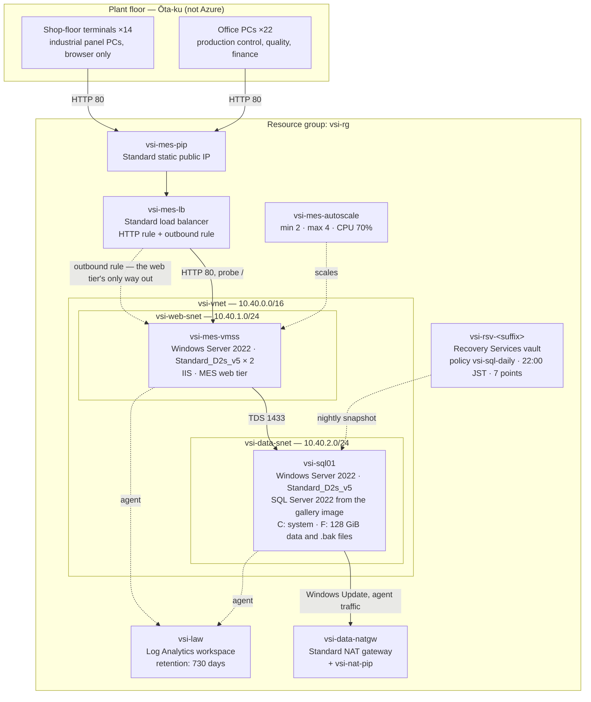

# The precision-parts MES operator (fictional) — Azure estate

The precision-parts MES operator (fictional) is a small manufacturer in Ōta-ku, Tokyo. It presses and
machines small metal components — brackets, shafts, housings — for two automotive tier-1 suppliers and a
medical-device firm. One plant, ninety-one people, roughly forty machine tools on the floor.

## How the estate got here

**1963.** Founded as a press shop by the current president's grandfather. Job tickets were paper until
1998.

**2014.** The plant bought its MES — referred to here as **the line-trace system** — from the MES vendor
(fictional; `mes-vendor.example`), a Japanese vendor with about thirty customers. It is a Windows ASP.NET
application with a SQL Server database. The vendor installed it on two servers in the plant's server room
— one web, one database — and has supported it the same way ever since: a remote session, an installer,
a maintenance window on a Sunday.

**2019.** The plant certified to IATF 16949 to keep the tier-1 work. The auditors began asking to see
traceability data — which operator, which machine, which lot — for parts shipped in the previous
production year.

**2022, June.** The server-room air conditioning failed twice in one summer, the second time on a
Saturday, and the database server was down until Monday morning. The president approved a move to Azure
that week. **The plant IT lead**, a one-person contractor who has looked after the plant since 2011,
did the move over three weekends: the same two servers, rebuilt from gallery images, the same vendor
installer, the database restored from a `.bak` file. Nothing was redesigned. The one change was the web
tier, which became a scale set of two instances behind a load balancer, because the plant IT lead had read
that this was how you were supposed to do it and it was no harder than building one server.

**2024, March.** Month-end close. Every supervisor closing work orders at once saturated both web
instances and the shop floor could not confirm orders for most of an afternoon. The plant IT lead added an
autoscale rule the following week. **The DBA** signed it off on the spot on the
understanding it had been explained to them: the web tier grows when the line is busy and shrinks when
the line stops. The line runs one shift, 08:00 to 17:00, with a short second shift on Tuesdays and
Thursdays, and nothing at all at weekends. Nobody has looked at the instance-count graph since the day
it was turned on.

**2024, August.** An audit finding: process data from the previous production year could not be
produced on request. **The operations manager** asked for two years of it to stay queryable.
The plant IT lead typed the number into the monitoring workspace's retention box that afternoon. Ingestion
has roughly tripled since — the MES writes more per work order after a 2025 vendor upgrade — and the
retention setting has not been revisited.

**2026.** The tier-1 customers are asking about Google Cloud, and the president wants to know what
moving would involve.

## Estate diagram

## Main services

| Service            | Resource(s)                                                                                                                                  | Notes                                                                                                                                                                                                                                                                                                           |
| ------------------ | -------------------------------------------------------------------------------------------------------------------------------------------- | --------------------------------------------------------------------------------------------------------------------------------------------------------------------------------------------------------------------------------------------------------------------------------------------------------------- |
| MES web tier       | `vsi-mes-vmss` — Windows Server 2022, `Standard_D2s_v5` × 2, Standard SSD OS disks                                                           | A scale set because the plant IT lead read that this was the modern shape, not because anything about the application needs one. Instances are cattle only in theory: the vendor's installer runs by hand on each one during a maintenance window, and an instance the platform replaces has to be rebuilt.     |
| Web entry point    | `vsi-mes-pip` + `vsi-mes-lb` (Standard), HTTP rule on 80, health probe on `/`, one outbound rule                                             | The shop-floor terminals and the office PCs both reach the MES over the public address. There is no TLS: the deployed 4.2 release of the line-trace system does not support it and the vendor has quoted for the upgrade twice.                                                                                 |
| Elasticity         | `vsi-mes-autoscale` — floor 2, ceiling 4, add one instance above 70% CPU                                                                     | The rule the DBA signed off in 2024. What it does at 03:00 on a Sunday has never been checked against what they were told it does.                                                                                                                                                                              |
| MES database       | `vsi-sql01` — Windows Server 2022, `Standard_D2s_v5`, SQL Server 2022 from the Azure gallery                                                 | A server, not a database service. SQL Server, its Agent, the maintenance plan and the vendor's stored procedures all live on the box, and the F: drive holds both the data files and the `.bak` files the plan writes.                                                                                          |
| Database licensing | none recorded in the deployment template                                                                                                     | Finance carries this machine under the corporate volume agreement — the company has held Software Assurance on SQL Server Standard since the 2014 on-premises install, and the renewal sheet still lists the plant. Whether that covers what is now running in Azure has never been checked against an invoice. |
| Egress             | `vsi-data-natgw` + `vsi-nat-pip` for the data subnet; the load balancer's outbound rule for the web subnet                                   | Two separate paths out because the two subnets got them at different times. Neither subnet has implicit outbound access to fall back on.                                                                                                                                                                        |
| Monitoring         | `vsi-law` — Log Analytics, pay-as-you-go, **730-day retention**                                                                              | The operations manager's two production years. Ingesting the data and keeping it now cost more between them than every virtual machine in the estate put together, which nobody has mentioned to the operations manager.                                                                                        |
| Backup             | `vsi-rsv-<suffix>` — Recovery Services vault, locally redundant; policy `vsi-sql-daily`, 22:00 JST, seven daily recovery points              | Protects `vsi-sql01` and nothing else. The plant IT lead's position is that a web instance can be rebuilt in an afternoon, so only the box holding data is worth protecting.                                                                                                                                    |
| Network security   | `vsi-web-nsg` (HTTP from the internet, probes from the platform), `vsi-data-nsg` (TDS from the web subnet, RDP from inside the network only) | The database server accepts nothing from outside the virtual network. That is also why there is no remote-desktop path into it from anywhere — see Known debt.                                                                                                                                                  |

## Application

The line-trace system 4.2, from the MES vendor (fictional). ASP.NET Web Forms against SQL Server, unchanged in shape since
2014.

- **Web tier.** IIS on each scale-set instance. The application is stateless per request but keeps
  session in process, so the load balancer's default five-tuple distribution is doing real work: a
  supervisor whose next request lands on the other instance is logged out. Everyone has learned to
  expect it and nobody has reported it as a fault in years.
- **Database.** One database, `mes_trace`, about 40 GiB. Roughly 190 tables. The vendor ships schema
  changes as `.sql` scripts run by hand on the maintenance window.
- **Scheduled work, all of it inside SQL Server Agent on `vsi-sql01`:**
  - 01:30 — index rebuild and statistics update (the vendor's script, unchanged since 2016).
  - 02:00 — maintenance plan writes a full `.bak` to `F:\Backup`. The vault picks the machine up at
    22:00; the `.bak` files exist because the plant IT lead wanted something restorable without going
    through the portal, and they are what actually gets used.
  - 02:30 — a stored procedure exports the previous day's completed work orders to
    `F:\Export\wo_YYYYMMDD.csv`, which the web tier serves to the finance PCs on request.
  - 05:00 — a purge job that has been failing silently since a 2025 schema change. Nobody watches the
    Agent job history.
- **There is no build, no pipeline and no source control for the application.** Deployment is the vendor
  connecting remotely and running an installer.

The static page the scale set's script extension writes at provisioning time is not part of the MES.
It is the placeholder the plant IT lead put in front of IIS in 2022 so the load balancer's probe had
something to succeed against before the vendor's installer had been run, and it was never taken out.

## Network & security

- One virtual network, `vsi-vnet` (`10.40.0.0/16`), two subnets, no peering and no gateway. Nothing
  connects back to the plant network; the shop floor reaches the MES over the internet like everyone
  else.
- `vsi-web-nsg` allows HTTP from the internet and probe traffic from the platform. Nothing else.
- `vsi-data-nsg` allows TDS 1433 from the web subnet and remote desktop from inside the virtual network.
  The only machines inside the virtual network are the web instances, and nothing lets anyone reach one
  of those interactively either, so in practice there is no remote-desktop path to the database server
  from anywhere.
- The web subnet's only route out is the load balancer's outbound rule; the data subnet's is the NAT
  gateway. Windows Update, the backup agent and the vendor's licence check all depend on them.
- No TLS anywhere. No web application firewall. No private endpoints. No key vault — the application
  connection string sits in `web.config` on each instance, which is where the vendor's installer puts it.
- Local Windows administrator accounts only. There is no directory: the plant's PCs are in a workgroup
  and always have been, and the line-trace system does its own user management in its own table.

## Operations

**How a change happens.** The plant IT lead emails the DBA, the DBA picks a Sunday, the vendor connects
remotely and runs whatever needs running. There has never been a staging copy of anything.

**How anyone gets a console.** Through the portal's serial console, which works because boot
diagnostics are on. There is no jump host and no VPN. This has been on the audit's minor-findings list
twice.

**Patching.** Windows Update, automatic, whenever the machines decide. The scale set's instances and the
database server reboot on their own schedule. The line has twice found the MES unavailable at 07:40 on a
Tuesday for this reason.

**Monitoring.** The workspace collects what the agents send. The plant IT lead installed those agents from
the portal, one machine at a time, on the afternoon the operations manager asked for the retention — they are not
in the deployment template and never have been, so a scale-set instance the platform replaces comes back
without one until somebody notices. Nobody has built an alert, a workbook or a query against the
workspace. When the MES is down, a supervisor telephones the plant IT lead.

**Backup.** The vault takes `vsi-sql01` nightly and keeps a week. A restore has been tested once, in
2022, by the plant IT lead, from the `.bak` file rather than the vault. The web tier is not protected at all.

### Known debt, in the plant IT lead's own words

- "The MES web servers are a scale set but I've never actually let it scale on its own — I'd have to
  rebuild the instance by hand afterwards anyway because the vendor's installer isn't in the image."
- "The database is a Windows box with SQL Server on it. It is not one of the Azure database things. I
  know people ask."
- "The licence question is finance's. I built it from the gallery in an afternoon and nobody told me
  which edition to pick."
- "The retention on the logging is what the operations manager asked for. I don't know what it costs and nobody
  has ever asked me."
- "There's no way to remote in unless you use the serial console. I know."
- "The 05:00 purge job has been red for a year. It doesn't stop anything working."
