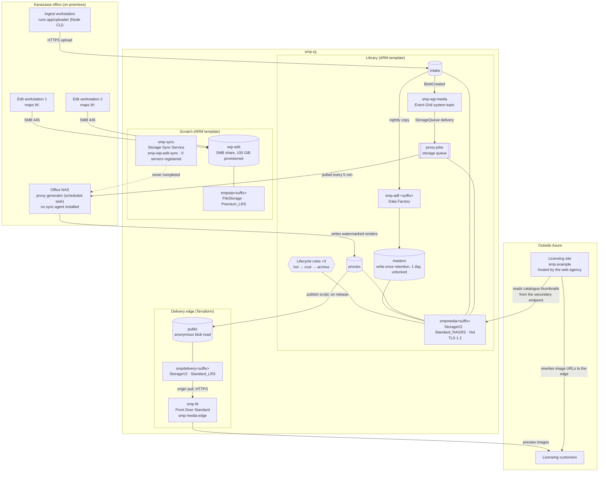

# The media-licensing operator (fictional) — Azure estate

The media-licensing operator (fictional) licenses photography and short-form video. It started in 2011 as a
two-person agency shooting for regional tourism boards, went stock-only in 2016 when the last of the
commissioned work dried up, and now sells web and print licences from a catalogue of roughly 340,000
frames. Eleven people: four photographers, two editors, a studio manager who also does the books, three
in sales, and a founder who still shoots.

The library lived on a NAS in the Kanazawa office until 2022, when a flood warning three streets away
convinced the founder to get it off the floor. A contractor moved it to Azure over one weekend, took a
portal export when he was finished, and that export is `arm/azuredeploy.json` — the studio manager has
hand-edited it since, but nobody has re-exported it. The delivery side is different: when the classic
CDN product stopped accepting new profiles in 2025, the studio brought in a second contractor who works
in Terraform, and she rebuilt the edge in `terraform/`. She did not touch the rest, and he was long
gone, so the estate has been described in two languages ever since.

What changed when:

- **2022** — lift from the office NAS. One storage account, one container, locally redundant.
- **2023** — the catalogue reorganisation. The `originals` container was renamed `masters` and web-sized
  renders were split into their own `proxies` container. The studio manager did the rename in the portal
  in an afternoon.
- **2024** — an insurance review asked what would happen if the region the library sits in went away.
  The answer was "nothing good", so the account was moved to read-access geo-redundant storage. The
  secondary is genuinely read: the sales team's catalogue browser was pointed at the secondary endpoint
  for thumbnails and never pointed back.
- **2024** — the edit bay's line is slow and the editors were pulling 400 MB raws over it all day, so a
  file-sync service was created to give the office NAS a local cache of the scratch share. Registering
  the NAS needs an agent installed on the box, which the studio manager has not got round to; the
  service and its sync group have sat there ever since with nothing attached.
- **2025** — an editor overwrote a delivered shoot with a re-edit and the original was gone. The studio
  put write-once retention on `masters` the same week. Counsel wants seven years; the studio manager set
  one day while she worked out what it would break, told everyone it was on, and it is still one day and
  still unlocked.
- **2025** — the edge rebuild in Terraform, with a public delivery origin in front of it.
- **June 2026** — a licensing dispute over a 2019 hotel campaign. Counsel asked for every frame from
  2019 to 2021, which meant pulling roughly 18 TB back out of the archive tier. The first two days were
  run at high priority before anyone read the price list. That month's bill was a little over twice the
  usual one, and the restored frames are still sitting in the hot tier.

## Architecture

## Main services

| Service         | Resource(s)                                                                               | Notes                                                                                                                                                                                                                                                                                                                                                |
| --------------- | ----------------------------------------------------------------------------------------- | ---------------------------------------------------------------------------------------------------------------------------------------------------------------------------------------------------------------------------------------------------------------------------------------------------------------------------------------------------- |
| Library storage | `smpmedia<suffix>`, StorageV2, `Standard_RAGRS`, Hot default tier                         | The whole catalogue. Read-access geo-redundant since the 2024 insurance review, and the sales team's thumbnail browser reads the secondary endpoint directly, so the secondary is load-bearing rather than a cold copy. Roughly 50 TB across the three tiers; archive holds the largest share, though a good deal less of it since the June restore. |
| Containers      | `masters`, `proxies`, `intake`                                                            | `masters` is camera originals, one folder per shoot. `proxies` is watermarked web renders, treated as disposable because they can be regenerated. `intake` is the landing area the photographers upload to and the factory empties nightly. There is no `originals` container — it became `masters` in the 2023 reorg.                               |
| Retention       | Time-based retention policy on `masters`, 1 day, Unlocked                                 | Blocks overwrites and deletes of anything inside the window. Unlocked means the studio can still shorten, extend or remove it, which is the only reason the studio manager was willing to turn it on. Counsel's seven years has never been applied and the policy has never been locked.                                                             |
| Lifecycle       | Management policy on `smpmedia<suffix>`, three rules                                      | `mastersCoolThenArchive` (cool at 30 days, archive at 180), `proxiesToCool` (cool at 60), and `originalsToArchive` (archive at 90) which predates the 2023 rename. Nobody has audited what the rules move since the reorg; the studio manager's view is that "the tiering is set up".                                                                |
| Scratch storage | `smpwip<suffix>`, FileStorage, `Premium_LRS`; share `wip-edit`, 100 GiB provisioned       | Where an edit lives while it is being worked on. Premium because the editors complained about scrub latency on standard. Provisioned at the 100 GiB floor and billed on that whether or not it is full — it usually runs around 30 GiB.                                                                                                              |
| File caching    | `smp-sync` Storage Sync Service, sync group `smp-wip-edit-sync`                           | Created in 2024 to cache the scratch share on the office NAS. No server has ever been registered against it and no cloud endpoint was ever added, so it does nothing and costs nothing. It is still on the studio manager's list.                                                                                                                    |
| Intake pipeline | `smp-adf-<suffix>` Data Factory                                                           | Moves the previous day's uploads out of `intake` into `masters`. The pipelines and linked services are authored in the ADF studio by the studio manager and live in the service; the 2022 portal export captured the factory itself and nothing inside it, and it has not been exported since.                                                       |
| Event fan-out   | `smp-egt-media` system topic, `smp-egs-proxy` subscription, `proxy-jobs` storage queue    | A blob landing under `intake/` becomes a message. The proxy generator is a scheduled task on the office NAS that drains the queue every five minutes, renders the watermarked copy and writes it into `proxies`. Nothing in Azure runs it.                                                                                                           |
| Delivery origin | `smpdelivery<suffix>`, StorageV2, `Standard_LRS`; container `public`, anonymous blob read | Only the watermarked previews the catalogue shows. Locally redundant because it is a copy of a copy — everything on it can be regenerated from `proxies`. The contractor's publish script pushes a shoot's previews here when sales release it.                                                                                                      |
| Edge            | `smp-fd` Front Door Standard, endpoint `smp-media-edge`                                   | Standard rather than Premium: the studio has never bought a firewall. No custom domain — the licensing site rewrites image URLs to the generated endpoint hostname at render time. Front Door is where the money goes; preview egress is the largest single line on the bill every month.                                                            |

## Application

There is no application tier in Azure. The studio has never had a server and has never wanted one: the
licensing site is a hosted product the web agency runs, the catalogue is a spreadsheet the studio
manager exports weekly, and the only code the studio owns is `app/uploader/`.

`app/uploader/` is a small Node command-line tool the photographers run on the ingest workstation after
a card dump. It walks a shoot folder and pushes each frame into the `intake` container; Event Grid does
the rest. Every Azure SDK call it makes goes through `app/uploader/azureClients.mjs`, which is the only
file in the tool that imports an Azure package.

It signs in with whatever session `az login` left on the workstation. There are no keys on the ingest
box and never have been — the founder was firm about that after reading about a stolen laptop.

Two subcommands exist for checking the tool rather than using it: `health`, which reports the tool's
hard dependencies, and `azure-check`, which pings each Azure service the tool touches and reports them
one by one. The studio manager runs `azure-check` when a photographer says "it's not working".

## Network & security

- **No virtual network anywhere.** Every account is reachable over its public endpoint, with
  `defaultAction: Allow` on the network rules and `AzureServices` bypassed. Nothing has a private
  endpoint. The contractor who did the 2022 lift priced a virtual network and the studio said no.
- **TLS 1.2 minimum is set explicitly** on all three storage accounts. The 2022 contractor set it on the
  library account after reading that leaving it unset permits older versions; the 2025 contractor set
  the same value on the delivery account.
- **Anonymous read is enabled on the delivery account only.** The library account has blob public access
  turned off, and the `public` container on the delivery account is the one anonymous surface in the
  estate. It holds watermarked previews and nothing else.
- **Shared key access is on everywhere.** The publish script and the studio manager's occasional Storage
  Explorer session both use account keys. Nobody has audited who has a copy.
- **Identity is one Microsoft 365 tenant** with eleven users, no groups worth the name, and the founder
  as the only owner. The data factory has a system-assigned identity because the wizard created one.
- **There is no firewall, no WAF and no DDoS plan.** Front Door Standard's inherent protection is what
  there is.

## Operations

**Deploys.** The library template is applied by hand by whoever is doing the work, which is the studio
manager for anything storage-shaped and the edge contractor for anything at the edge. The two are
applied in a fixed order — the edge tree first, the library template second — because that is the order
the runbook lists them in and the studio manager has never questioned it.

**Monitoring.** A cost alert at USD 1,500 a month, added after the June bill, and nothing else. No
Application Insights, no Log Analytics workspace, no alert rules on any resource. The way the studio
learns something is broken is that a photographer says an upload failed.

**Backup.** The RA-GRS secondary is what the studio calls its backup. There is no Recovery Services
vault, no blob versioning, no soft delete, and no point-in-time restore. The retention policy on
`masters` is the only thing standing between a wrong `Remove-Item` and a lost shoot, and it protects
one day of it.

**Support.** The 2022 contractor is uncontactable. The 2025 edge contractor answers email within a week
and bills by the hour. Between them, the studio manager.

### Known debt

In the studio manager's words, from the note she keeps in the shared drive:

- "The delivery account is set to Hot in our template and Cool in [the contractor's]. She says the old
  catalogue is cold and Cool is a third of the price; I say people look at previews all day and a cool
  read is charged per gigabyte. Whichever of us ran last is what it ends up on. Needs settling."
- "Pulling those 18 TB back out of the archive in June cost about USD 800 in retrieval on its own,
  which is six months of what we pay to keep the whole archive sitting there. Nobody told us getting
  it back was the expensive part. The first two days were on the fast setting, which is five times
  the price a gigabyte and ten times an operation. And it is all still in Hot, which has put about
  USD 850 a month on the bill and will until the tiering rules take it back down in December."
- "The tiering rules were written before we renamed anything. I don't know which of them are still
  doing something."
- "The file sync thing needs the agent on the NAS. It has needed that for two years."
- "Lock the retention policy. Counsel says seven years. I need to know what happens to a shoot we are
  contractually told to delete before I set that to anything I cannot undo."
- "Ask [the contractor] whether the secondary endpoint the sales browser reads is actually covered if
  the main region goes. I think it is but I do not know."
