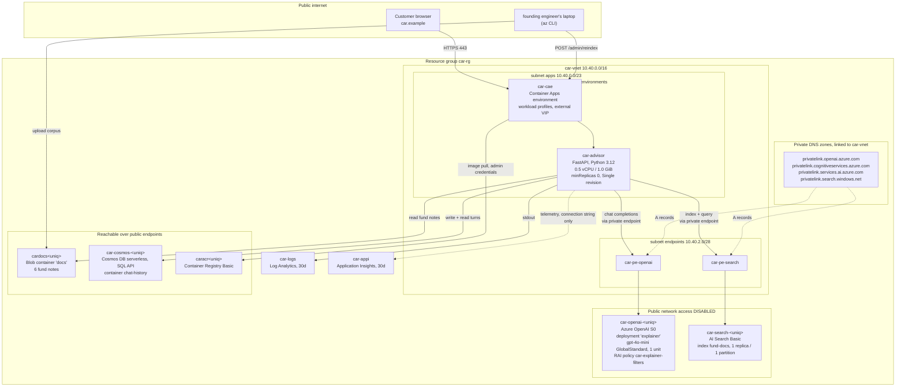

# The robo-advisory operator (fictional) — Azure estate

The robo-advisory operator (fictional) is a startup in a regional city. It was founded in 2022 by
two people who had spent a decade building risk systems at a regional bank and had grown tired of
explaining to customers, one phone call at a time, why their portfolio held what it held. The product is
a discretionary managed account with six underlying funds and a small number of model portfolios; the
part everybody actually talks about is the **portfolio explainer**, a chat box that answers "why do I own
this?" in plain Japanese and English, citing the fund documentation it drew the answer from.

The company has eleven employees. Two of them write code.

## How it got here

- **2022** — founded. The first version of the explainer was a hand-written decision tree with about two
  hundred canned answers, running on a single App Service instance. It was accurate and nobody liked it.
- **2024** — the explainer was rebuilt as a retrieval-augmented chat service against Azure OpenAI, on
  `gpt-4o-mini` because it was the cheapest model that could hold three fund notes in context and still
  write a readable paragraph. The fund documentation moved into blob storage and an Azure AI Search index
  went in front of it. This is the architecture that is still running.
- **2025 Q1** — the service moved off App Service onto Container Apps. The reason was cost, not
  architecture: the explainer is idle overnight and at weekends, and a plan that bills by the hour was
  paying for a great deal of nothing. Scale-to-zero cut the compute line by roughly four fifths.
- **2025 Q3** — an FSA-adjacent readiness review before a funding round. Two things came out of it and
  both are still in the estate: the model account and the search service were put behind private
  endpoints and had public network access switched off, and the content filtering policy on the model
  deployment was re-cut category by category rather than left on the platform default.
- **2026 Q1** — a Microsoft account rep pitched provisioned throughput as the fix for "inconsistent
  latency", and a month-to-month reservation for 15 provisioned throughput units was signed. Nobody
  re-pointed the application at a provisioned deployment. The explainer still talks to the pay-per-token
  deployment it always talked to, and the reservation has sat beside it ever since, billing by the hour.
  The finance lead has raised it twice.

The founding engineer maintains all of it. There is no platform team.

## Diagram

## Main services

| Service             | Resource(s)                                                                               | Notes                                                                                                                                                                                                                                                                                                                                                                                                                                                                                                                                                                                                                                                                                      |
| ------------------- | ----------------------------------------------------------------------------------------- | ------------------------------------------------------------------------------------------------------------------------------------------------------------------------------------------------------------------------------------------------------------------------------------------------------------------------------------------------------------------------------------------------------------------------------------------------------------------------------------------------------------------------------------------------------------------------------------------------------------------------------------------------------------------------------------------ |
| Compute             | `car-cae` (Container Apps environment), `car-advisor` (container app)                     | Workload profiles environment on the built-in Consumption profile, integrated into `car-vnet` — the network integration is not a preference, it is the only way the app can reach the two private endpoints. `minReplicas` is 0, so the first request of the morning waits a few seconds for a replica. Single-revision mode: publishing a new revision deactivates the previous one, so there is nothing to weight traffic across and no warm rollback target. The founding engineer has broken production twice this way and still prefers it to reasoning about two live revisions.                                                                                                     |
| Model               | `car-openai-<uniq>` (Azure OpenAI, S0)                                                    | One deployment, `explainer`, on `gpt-4o-mini` at GlobalStandard with a capacity of 1 — that is 1,000 tokens per minute, which is the smallest unit Azure meters and comfortably more than eleven people generate. The account sits in its own region parameter because model availability is per region and per deployment type. Keys are switched off entirely; the app authenticates with its managed identity.                                                                                                                                                                                                                                                                          |
| Content filtering   | RAI policy `car-explainer-filters` on the deployment                                      | Not the platform default. The stock filter kept refusing legitimate questions about market crashes and aggressive allocations, so thresholds were re-cut per category: hate and violence block only at High severity on the prompt side and Medium on completions, self-harm blocks from Low in both directions, sexual content at Medium. Separately, and not visible in any template, the robo-advisory operator (fictional) applied for and was granted **modified abuse monitoring** — prompts and completions are not retained by Microsoft for human review. That approval is a support-ticket artefact; there is no resource, property or export anywhere in Azure that records it. |
| Retrieval           | `car-search-<uniq>` (AI Search, Basic)                                                    | One replica, one partition, index `fund-docs`, six documents. Basic rather than Free because a Free service cannot take a private endpoint at all, and there is only one Free service per subscription anyway. Basic also cannot run a skillset indexer behind a private endpoint, which is why nothing pulls from blob storage on a schedule — the application reads the corpus and pushes documents into the index itself, through `POST /admin/reindex`. Semantic ranking is off; plain full-text over six short notes was indistinguishable in testing.                                                                                                                                |
| Documentation store | `cardocs<uniq>`, container `docs`                                                         | Six markdown fund notes, one per fund. This is the only storage the estate has and it holds less than four megabytes. Shared-key access is off; both the app and the operator uploading the corpus authenticate as themselves.                                                                                                                                                                                                                                                                                                                                                                                                                                                             |
| Conversation store  | `car-cosmos-<uniq>`, database `explainer`, container `chat-history`                       | Serverless SQL API, partitioned on `/sessionId`. Nothing is ever deleted — the compliance position is that an explanation given to a customer is a record. The indexing policy covers only the partition key and the timestamp, because nobody has ever queried the answer text. Data-plane access is a Cosmos-specific role assignment on the account, not an Azure role assignment, which is a distinction the founding engineer learned the hard way.                                                                                                                                                                                                                                   |
| Registry            | `caracr<uniq>` (Container Registry, Basic)                                                | Holds one repository, `car-advisor`. The admin account is enabled and the container app pulls with a registry username and password rather than with its own identity — granting the identity a pull role needs a role assignment, and the founding engineer does not reliably hold that right on the subscription.                                                                                                                                                                                                                                                                                                                                                                        |
| Network             | `car-vnet`, subnets `apps` and `endpoints`, two private endpoints, four private DNS zones | The zones are what make the endpoints work: without them the app resolves the model account's public name to its public address, the request leaves the network, and the account refuses it. The model account carries three zones rather than one because Azure publishes `openai.azure.com`, `cognitiveservices.azure.com` and `services.ai.azure.com` as a set for one account endpoint.                                                                                                                                                                                                                                                                                                |
| Observability       | `car-logs` (Log Analytics, 30d), `car-appi` (Application Insights)                        | Container stdout streams to the workspace, which keeps 30 days. Application Insights here is workspace-based, so the workspace governs its retention too and the component's own retention property is decoration. The connection string is on the container app and the SDK is not — the component exists, is billed for, and receives nothing but whatever the platform sends. Nobody has opened it since it was created.                                                                                                                                                                                                                                                                |

## Application

`app/advisor/` is a FastAPI service on Python 3.12, one container, three product routes plus two
admin routes:

| Route                       | Purpose                                                                                                                                                                               |
| --------------------------- | ------------------------------------------------------------------------------------------------------------------------------------------------------------------------------------- |
| `GET /health/live`          | Is the process up? Touches nothing outside it. This is what the platform's start-up and liveness probes call, so that a slow dependency cannot get the container restarted.           |
| `GET /health`               | Per-dependency substatus. Never raises, and each dependency is probed under a deadline so an unreachable one is reported rather than waited on.                                       |
| `POST /explain`             | The product. Retrieves up to three passages from the index, builds the prompt, generates the explanation, writes the turn to Cosmos DB, returns the answer with its citations.        |
| `GET /history/{session_id}` | Every explanation given in one session, oldest first. Single-partition query.                                                                                                         |
| `POST /admin/reindex`       | Creates the index if needed, reads the corpus out of blob storage, pushes the documents in. Runs inside the app because the search service is only reachable from inside the network. |
| `GET /admin/azure-check`    | Per-service dependency dashboard.                                                                                                                                                     |

Every Azure SDK call in the service goes through `app/advisor/azure_clients.py`. That was the founding engineer's rule from
the first commit and it has held.

**`LLM_MODE`.** The explainer ships configured as `stub`. In stub mode the service retrieves exactly as
it always does, builds exactly the same prompt, and then composes the final paragraph from the retrieved
passages locally instead of calling the model. Retrieval, citation, persistence and history are all
live; only the wording of the last paragraph is not. It exists for two reasons: the desk can flip it on
without a redeploy when the model account throttles, and a new subscription can stand the estate up and
verify it end to end before anybody has confirmed the model quota. `live` is one parameter away.

## Network & security

- Public network access is **Disabled** on the model account and on the search service. Neither answers
  on its public address. The two private endpoints are the only path in, and the private DNS zone group
  on each is what makes the ordinary hostname resolve to the endpoint from inside `car-vnet`.
- The container app has a **system-assigned managed identity** and five grants: four Azure role
  assignments — Cognitive Services OpenAI User on the model account, Search Service Contributor and
  Search Index Data Contributor on the search service, and Storage Blob Data Reader on the documentation
  account — plus a Cosmos DB data contributor assignment on the Cosmos account, which is a different
  mechanism from the other four.
- Both the model account and the search service have local authentication switched off, so account keys
  and admin keys do not exist to be leaked.
- The container app's ingress is external. The environment carries an external virtual IP because the
  explainer has to be reachable by customers; only the two back-end services are private.
- Storage keeps `minimumTlsVersion` at `TLS1_2` and shared-key access off.
- Egress from the app subnet is the platform default — no NAT gateway, no user-defined routes, no
  firewall. Every `Microsoft.Network` resource is pinned to an api-version no later than 2024-05-01,
  because later versions create subnets with default outbound access switched off and the environment
  would then be unable to pull its own image.

## Operations

**Deploys.** The founding engineer runs `scripts/deploy.sh` from their laptop. It builds the image with the registry's build
service, so there is no Docker daemon involved, and then runs the template. There is no pipeline. There
is no staging environment — single-revision mode means the new revision replaces the old one and the
verification is `scripts/smoke-test.sh` against production, run by hand, usually on a Friday afternoon.

**Patching.** The Python dependencies are pinned in `app/advisor/requirements.txt` and bumped when
something breaks or when a scanner complains. The base image is `python:3.12-slim` and is rebuilt on
every deploy, which is the only reason it stays current.

**Monitoring.** There is none, in the sense the word is normally used. Container stdout goes to Log
Analytics and stays there for thirty days. Application Insights is provisioned and instrumented with
nothing. There are no alert rules. The way the robo-advisory operator (fictional) finds out the explainer is broken is that a customer
emails the support address, or the founding engineer notices while using it.

**Backups.** The Cosmos DB account runs on the default periodic backup and nobody has ever tested a
restore. The fund documentation exists in the marketing team's shared drive as well as in blob storage,
which is the closest thing the estate has to a considered backup strategy. There is no runbook.

### Known debt

In the founding engineer's words, from the wiki page last edited in March:

- "The PTU reservation is money on fire. I never pointed anything at it and I do not think we can get out
  of it until the month rolls. Ask before renewing."
- "Application Insights does nothing. Either instrument the app properly or delete the component — right
  now we pay for a dashboard that is always empty."
- "Single revision mode is a footgun and I keep the footgun. If I ever want a real rollback I have to
  change the mode, and changing the mode on a live app is its own outage."
- "The registry admin account should be an identity pull. It needs a role assignment I cannot make."
- "Nothing in the conversation store is ever deleted. That is a compliance decision, but somebody should
  put a number on how big it gets by 2030."
- "The content filter thresholds are tuned to what our customers ask. If we ever move this anywhere else,
  that tuning is eleven support tickets of institutional knowledge and it is written down in exactly one
  place, which is the template."
