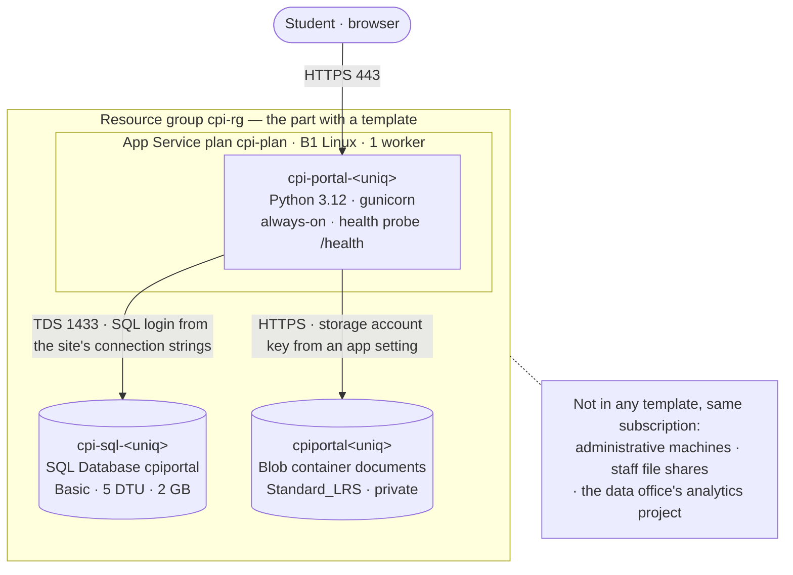

# The university's Azure estate (fictional)

The university behind this estate (fictional) was founded in 1952, with four faculties and
about 6,800 students. Its IT office is three people: the head of IT, who has run it since 2009, one
systems administrator, and a part-time assistant during term.

Everything used to live in a server room on the fourth floor of Building 4. The move to Azure was not
a project — it happened in pieces, and each piece was clicked together in the portal by whoever needed
it that week:

- **2018.** Building 4 was refurbished and the server room had to be emptied inside a term. A local
  systems integrator lifted the staff file shares and two administrative servers into Azure over a
  fortnight. Nothing was written down beyond the invoice.
- **2020.** Teaching went online in March with about a week's notice. More services were stood up
  quickly — additional administrative machines, more file storage, and a course-booking system on a
  pair of web servers behind a load balancer.
- **2023.** The course-booking system was retired and replaced with a hosted product the faculty
  offices buy directly. The web servers and the load balancer were deleted. Not everything that was
  created alongside them was.
- **2024.** The data office — which is part of the registrar's office, not the IT office — started an
  enrolment and retention analytics project on Azure Synapse Analytics. They commissioned it
  themselves, they run it themselves, and the head of IT has never had a login for it. It is on the
  same subscription because that is the subscription the university has.
- **2025.** The student portal was rebuilt. The old one was a PHP application on one of the 2020
  machines, and it fell over during every registration week. Two developers in the web team rebuilt it
  as a Python application on App Service, and — because one of them had used it at a previous
  employer — wrote a Bicep template for it. **That template is the only part of this estate that has
  ever been in source control.** It is in `bicep/`, it covers the portal, and it covers nothing else.
- **2026.** The university's finance committee has asked what it would cost to run all of this
  somewhere other than Azure, which is why anyone is looking at it at all.

Staff machines and the administrative servers are joined to the university's directory, and staff sign
in to them with the same account they use for everything else. That arrangement predates Azure — it
was how the Building 4 servers worked — and it came across unchanged.

## Student portal

## Main services

Deployed by `bicep/main.bicep`. Nothing else in the subscription is.

| Service  | Resource(s)                                                                      | Notes                                                                                                                                                                                                                                                  |
| -------- | -------------------------------------------------------------------------------- | ------------------------------------------------------------------------------------------------------------------------------------------------------------------------------------------------------------------------------------------------------ |
| Compute  | App Service plan `cpi-plan` (B1 Linux, one worker)                               | B1 is the cheapest tier that keeps the site warm. The web team tried the Free tier first; the first request of the morning took long enough that the student office started getting phone calls about it, so they moved up one step and stopped there. |
| Web      | Web app `cpi-portal-<uniq>` (Python 3.12, gunicorn)                              | Always-on, HTTPS only, TLS floor 1.2, FTP publishing switched off. The platform's health probe is pointed at `/health`. The site has no identity of its own — see below.                                                                               |
| Database | SQL logical server `cpi-sql-<uniq>`, database `cpiportal` (Basic, 5 DTU, 2 GB)   | The notice board is a few hundred rows read a few thousand times a day, and it has never needed more than the smallest service objective. Backups are the platform's default retention; nobody has ever restored one.                                  |
| Storage  | Storage account `cpiportal<uniq>`, container `documents` (Standard_LRS, private) | The registrar's office publishes forms and handbooks here. Public blob access is off and the container is served back through the site, because a document that leaked to a search engine in 2019 is still remembered.                                 |

## Application

A small Flask application. Students see a notice board, a page per notice, and a list of the documents
the registrar has published; documents download through the site rather than from a link to storage.
`/health` reports on both dependencies, and `/admin/azure-check` is the page the web team opens when a
student says something is broken.

Every Azure call the application makes goes through `app/portal/azure_clients.py`. There is exactly one
of each: the document library, and the notice board.

The site has **no managed identity**, and this deployment creates no role assignments. It reaches
storage with the storage account key and the database with a SQL login and password, both delivered as
site configuration — the key as an application setting, the database credentials as a connection string
entry named `PortalDb`, which is where the portal blade puts them. This was not a considered decision.
The web team configured the site by hand in the portal in 2025, that is what the portal walks you
through, and when the template was written afterwards it reproduced what was already running. Nobody
has revisited it since.

Seeded content is five notices and two published documents, loaded by `scripts/seed.sh`.

## Network & security

There is no virtual network in front of any of this. The portal, the database and the storage account
all sit on public endpoints:

- The SQL logical server keeps the **allow Azure services** firewall entry, because the App Service
  workers egress from shared addresses nobody could pin to a range. Operators connecting from a laptop
  add their own address and remove it again.
- The storage account has public blob access disabled, TLS 1.2 as the floor, and shared-key access
  left on — the portal has no other way in.
- HTTPS only on the site, TLS 1.2 floor, FTP publishing disabled.

The administrative machines elsewhere in the subscription are a different story: they are reachable on
the university network and are administered by remote desktop, which is how the 2018 integrator set
them up.

## Operations

- **Deploys.** The portal is deployed by running `scripts/deploy.sh` from a laptop. There is no
  pipeline. The web team deploys during the quiet fortnight in August and again at the New Year, and
  otherwise leaves it alone.
- **Everything else** is changed in the Azure portal, by hand, by whoever is dealing with the problem.
- **Monitoring** is a student telephoning the office. There is no alerting on any of it. The head of IT
  looks at the subscription's cost page once a month, mostly to check that it has not moved.
- **Backups.** The database has whatever the platform does by default. The file shares are backed up
  because the 2018 integrator configured it and it has kept running. Nobody has tested a restore.
- **Licensing.** The finance office has always been told that the Windows machines are covered by the
  university's existing agreement with the vendor, and that is the answer given whenever anyone asks
  about the line items. Nobody in the IT office knows which agreement is meant or where it is filed.

### Known debt

The head of IT's own list, unedited, from the note attached to the finance committee's request:

1. "The portal has a template. Nothing else does. If I am hit by a bus, someone will have to open the
   portal and write down what they find, the same way I would have to."
2. "When we killed the booking system in 2023 we took out the servers and the balancer. There is an
   address left over from it that has been on the bill every month since. I have never worked out
   whether deleting it breaks something, so I have not deleted it."
3. "The data office's analytics work is on our subscription and I have no visibility of it. I get
   asked about the cost of it every year and I have to go and ask them."
4. "The admin machines are joined to the directory. Anything we do with them has to keep that working
   or nobody can log in, and I do not know what that looks like anywhere else."
5. "We are paying for some things up front on some kind of commitment. It was set up before my time
   with the reseller and I only see the effect of it on the invoice, not the thing itself."
6. "The file shares have grown every year since 2018 and nobody has ever deleted anything off them."

Enquiries: the student office, Building 1 — `cpi.example`.
